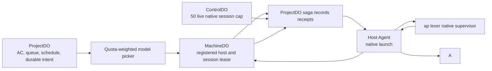

# Hub 2.0 architecture

Status: As of 10 November 2026, the quota-weighted model picker, global cap of 50 live native sessions, and inactive-session reaper described here are merged and deployed; end-to-end production acceptance evidence is tracked separately.

## Goal and boundaries

Preserve the Hub workflows used by operator skills and the aplexer bridge, including the canonical repository registry explicitly required by Alexey. The 6,000 product-SLOC architecture target remains visible; do not minify or drop retained features to hit it. The prior 8,962-SLOC approval described an older source tree and is not a limit on this simplified design. Report SQL rows, alarm writes, requests, duration, CPU and storage separately. Idle background work remains zero when no work is due.

The Worker never runs model processes. ProjectDO owns intake, queue, dependencies, schedules and durable launch intent. For a start, it picks a model by configured policy and quota headroom, selects a registered host, and dispatches without per-account or per-host capacity reservations. ControlDO counts fresh native-session snapshots toward one global limit of 50. MachineDO periodically reaps dead, exited, and idle sessions and records confirmed stops.

The Hub Host Agent prepares the private provider configuration and child-scoped context, then invokes aplexer/native directly. It reports the real native identity and live pane activity, and confirms stop/exit through native process status. Quota and credential problems may select a fallback model; they do not create an admission hold. The adapter preserves session authorization, idempotency, deadline, stop, and receipt behavior.

Provider quota is used to weight model selection; it is not a start gate. Hub does not replace Agent Branches. Canonical repository metadata is Hub state; host checkout scanning and worktree mechanics are separate responsibilities.

Use SQLite-backed Durable Objects and static assets. Alexey reports the account's free Cloudflare allowance is exhausted for this month, so all forecasts and limits use fully marginal paid rates; no free-operation claim is allowed. Count SQL rows scanned and written, including indexes; separately instrument requests, active duration, alarm invocations/writes, Worker CPU, storage and any legacy KV. Statement counts and SQL rows alone do not establish a bill ceiling. See [cost controls and alert status](COST-CONTROL.md), [DO pricing](https://developers.cloudflare.com/durable-objects/platform/pricing/), [Worker pricing](https://developers.cloudflare.com/workers/platform/pricing/), [KV pricing](https://developers.cloudflare.com/kv/platform/pricing/), [hibernation](https://developers.cloudflare.com/workers/best-practices/websockets/), and [alarms](https://developers.cloudflare.com/durable-objects/api/alarms/).

## Components and routing

| Component | Responsibility and ownership |
| --- | --- |
| Worker edge | Static assets, bounded API/MCP validation, OIDC callbacks, authenticated webhook ingress; no client-selected internal authority |
| ControlDO | Identities, credential families and revocation, named-agent delegation/forwarding, canonical repository registry, project aliases, small policy, compact object routing directories |
| ProjectDO | One canonical project's intakes, original asks/provenance, AC, task events, dependencies, claims, queue, dispatch saga and schedules |
| MachineDO | One enrolled host's capabilities, connection/freshness, live session snapshots, commands, native evidence and deadlines |
| AccountDO | One provider account's sealed credentials, refresh generation, quota/reset discovery and expiry alerts |
| CostController | Separate USD/day reservations, category usage, alert dedupe and runaway stop/recovery budget; consulted before expensive fanout and retries, but never treated as provider quota |
| MailboxDO | One actor's durable outbox/deduplication ledger, inbox projections and delivery receipts |
| Host agent | Outbound transport, persisted launch/command journal, direct native aplexer invocation, provider home, native state/work/mailbox bridge |
| CLI/MCP | Compatible authorized contracts; CLI waits may use a bounded WebSocket; MCP reads are short and paged |
| Dashboard | Phone-friendly inbox, intake, session, fleet, quota/reset alerts and health views through bounded authorized projections |

The launch path is coordinated but not globally atomic:

Each step uses the existing owner authority and an idempotent operation/epoch. If a session reservation or native step fails, ProjectDO records and retries compensation. Only a fresh machine snapshot of a live pane with recent activity counts toward the global cap; DB state alone never does. The reaper asks the host to stop dead or idle panes and records confirmed exits. Unknown quota receives a small picker weight, and an authentication failure advances to the next allowed candidate.

ControlDO owns `object_routes(kind,id,owner)` for intake, session, message and schedule IDs, plus indexed name/alias lookups. Existing UUIDs and minimum-six-character unique intake prefixes remain usable without a project argument: an indexed prefix range returns at most two authorized matches and refuses ambiguity. New route registration is a durable idempotent step before an object is publicly discoverable. Missing routes are repaired from a bounded creation or recovery journal, never by unbounded shard scans or Hub1 imports. Directory retention follows the retained records.

Repository records retain canonical owner/name, active/archived/duplicate status, duplicate target, purpose, labels, aliases, stack, key folders, URLs and domain metadata. Operator metadata survives refresh. Project aliases resolve to one canonical ProjectDO before dispatch, deduplication or claims. Work on the same canonical repository uses that project's claim authority; an alias cannot create a second conflict domain. A multi-repository operation must declare each canonical scope and acquire all claims or release partial acquisitions before editing.

## Storage and query contracts

Tables below name the required keys and query indexes, not a complete executable schema. Every owner has a schema-version record and `deadlines(kind,key,due_at)` with a unique `(kind,key)` and `(due_at,kind,key)` index. Every persisted idempotency record stores the request digest, result and retention deadline; a changed request under the same key conflicts.

| Owner | Tables and essential query indexes |
| --- | --- |
| ControlDO | credentials: unique token hash, family/revocation generation; device_pairings: unique code hashes/user codes; named_agents and delegates: actor/family/client; repos: unique canonical name, `(status,name)`, unique aliases and duplicate target; object_routes: unique `(kind,id)` and indexed names; project_aliases; policy |
| ProjectDO | intakes: ID, source message key, verbatim text, transcription/source reference/time, ordered AC, status, priority, promotion, version and timestamps; `(status,updated_at,id)`; intake_events `(task_id,seq)`; ask_mappings `(source_actor,source_message_id)`; dependencies unique `(task_id,prerequisite_id)` and reverse index; claims `(scope,expires_at)` for active rows plus `(expires_at,id)`; scope_ancestors `(ancestor,claim_id)`; queue and sagas as specified below; schedules `(enabled,next_due_at,id)` |
| MachineDO | machine/capabilities and live snapshots; sessions: unique operation/native IDs, `(intake_id,created_at)`, `(state,updated_at,id)`; commands: unique `(session_id,key)`, `(session_id,seq)` and due receipt/ack deadlines; native observations, completion-report outbox and confirmed-stop receipts |
| AccountDO | account/generation, quota snapshot and reset grants `(available,expires_at,id)`; discovery deadline |
| MailboxDO | sender outbox: unique `(sender,key)`, message ID, immutable digest, current recipient, route epoch and transition journal; recipient inbox: unique message ID, `(state,created_at,id)`, `(thread_id,created_at,id)`; delivery events `(message_id,seq)`; `(expires_at,id)` for bounded retention |

Lists use bounded keyset pages with stable tiebreaks; full CLI walks preserve the existing snapshot/list-token or explicit stale-snapshot restart contract. Authorization applies before returning a page or prefix result. A global list carries bounded per-shard cursors; fan-out, authorization and empty shard reads count in its budget. No request path scans historical JSON, performs offset pagination, counts an unbounded table or sweeps all expiries.

## Bounded read-cache experiment

The DO-local `ReadCache` may retain only simple deterministic single-table `SELECT` results, with cloned values and strict per-instance entry/byte bounds. Joins, CTEs, subqueries (including SQLite's `IN table-name` shorthand), functions, clock expressions, comments, multi-statement SQL, unknown bindings and unsupported query shapes bypass caching. Cache hits/misses/entries/bytes are reported separately; SQLite cursor rows-read/rows-written counters change only when SQL actually executes.

Every mutation invalidates its table before execution; unknown SQL and DDL clear the cache. A failed transaction clears all cached rows. Initial schema and declared migrations are audited before any schema SQL runs; triggers, views, virtual tables, cascade/set-null/set-default actions and SQL comments are rejected. Production SQL must use `MeteredDb`; authorization decisions are never cached, and credential expiry/revocation is rechecked for each request even when the credential row is cached. No separate SQLite catalog query is added for the schema audit.

If SQL execution, cursor materialization, or counter access throws, MeteredDb marks the measurement invalid, increments its error count, clears cached rows, and rethrows. Missing, non-finite, or negative row counters also invalidate the measurement; none may be interpreted as zero-cost. The native normal-day gate rejects every invalid measurement.

Typed conflict/refusal paths must precheck known conflicts inside their transaction or use conflict-aware SQL so expected 4xx outcomes do not throw SQLite constraints and poison later cost snapshots. Unexpected SQL exceptions remain unknown-cost and fail closed.

This is an experiment, not an accepted cost saving. It must pass exact-head core, authentication, account/mail, restart and idle gates, receive independent code review, and show a material reduction on the full required normal-day profile. If it adds no material benefit or weakens cache coherence, remove the module and mount. Never count cache hits as SQL rows saved when counters lack evidence.

`intake list --all` and archived/history retrieval retain prior asks. `--search`/API `q` is implemented as a bounded client-side page walk over authorized title/text/context; MCP returns a bounded continuation rather than claiming an incomplete search is complete. This deliberately incurs reads proportional to searched history. A future server search index requires its own measured read/write budget. Archived asks remain searchable; retention may remove ephemeral transport data after its deduplication window, never silently delete intake history.

Claim conflicts include ancestor/descendant path scopes, not just equal strings. Check indexed ancestors and bounded descendant ranges in the canonical project transaction; refuse an observation-limit result rather than treating it as no conflict. Preserve native `hub.work-claim.v1` claim/heartbeat/complete/abandon/steal/handoff events and local-first work declarations. TTL renewal, cleanup and redacted audit events are measured work.

## Queue, saga, fencing and recovery

The autonomous queue is an explicit durable state machine. Intake creation with AC inserts an eligible queue record in the same ProjectDO transaction, unless a live assignment, dependency or completion-review hold already owns it. Editing AC and dependency completion update eligibility. Read-only context/show never launches a process.

Preserve promotion and priority behavior: promoted first (newest promotion first), then high/normal/low, then newest intake with ID as tiebreak. Due-time and precedence are separate indexes: an indexed due lane moves a bounded batch into a ready lane indexed by precedence; delayed rows cannot block ready work. Due-time ties use sequence order. Explicit session starts use FIFO within their ready lane. Do not describe all queue selection as FIFO. Each transaction handles one bounded item and arms the next deadline if more work remains. Eligibility/dependency notifications are durable idempotent outbox events to subscribed projects, with bounded replay after disconnect; their retries and reads are budgeted.

ProjectDO owns each dispatch saga: `operation_id`, immutable request/digest, session ID, attempt, epoch, selected model/host, step, `next_action_at`, retry count and last reason. Index `(next_action_at,operation_id)` for nonterminal rows. Pop the queue and create the saga plus its deadline atomically. Dispatch retries reuse the same operation ID and query the host journal after ambiguous timeouts. Bounded retries escalate visibly with intake context instead of deleting work. Durable alarms do not replace this journal.

MachineDO issues increasing epochs for a session operation; reservations accept only the current authorized epoch and retain terminal receipts through the retry window. The host fsyncs operation ID, epoch and intended native identity before launch and records the resulting UUID. A restart reconciles the journal against native census before retrying; a crash between spawn and receipt is uncertain, never permission to spawn again. Stale offers/commands are rejected against the host's persisted high-water epoch. A replay returns the prior receipt. Native launch acknowledgement and first actual agent activity are separate states.

An unclaimed offer may expire. A live process remains bound to its session until native stop/exit evidence arrives. The global cap is based on fresh native process and pane activity, not session rows. Remote epoch changes cannot fence off an isolated running process. Replacements on the same task require confirmed predecessor stop or an explicitly acknowledged, isolated handoff. No claim is silently stolen on a timer. Late receipts reconcile to the original operation and cannot resurrect a cancelled or superseded intent.

MachineDO persists deadlines for offer receipt, first activity, command receipt/ack, host freshness/offline alert and session progress. The periodic reaper detects dead/exited panes and sessions idle for six hours; it stops leftover native processes, records the reap and releases the live cap. A reconnect replays unacknowledged events from host journals and retries pending report forwarding without duplicate intake events.

A durable session wake has pending, queued, delivered, acknowledged, missed and resolved states. `waiting_until` suppresses stall/nudge while the future wake is pending. No native inbox receipt within ten minutes of due time opens attention; after receipt, no verified ack within ten minutes of delivery also opens attention and an intake recovery event. A late ack resolves attention but preserves the missed deadline history. Recurring prompts coalesce while busy, retain delivery evidence and end with their session unless explicitly rebound by an operator.

Every DO schedules its one alarm for the earliest nonterminal deadline: queue, saga retry, reservation/claim expiry, host freshness, wake/command ack, report forwarding, reset discovery/alert, retention or enabled recurrence. A transaction updates state and its deadline; duplicate alarm execution is harmless. No alarm is needed when no such work exists. There are no periodic empty-queue scans. Correctness recovery, revocation and deadline delivery remain enabled under budget pressure; optional summaries may be reduced.

## Cross-shard messages

The sender's MailboxDO is the sole authority for `(sender,idempotency_key)` across all recipients, matching the existing bus conflict contract. It assigns a stable message ID and route epoch, records an immutable payload digest and persists an outbox step before delivery. Recipient MailboxDO inserts an inbox projection idempotently by message ID/epoch and returns a receipt; the sender retries until recorded. One logical message may have several projections, but only the authorized current recipient epoch can deliver it. Directory registration is another replayable outbox step.

Replies authorize against a stable parent-message participant record at its sender owner, inherit the thread ID, and create a new sender-owned outbox entry. Thread history uses bounded participant-authorized mailbox pages and explicit cursors; no global thread scan is assumed. Stage events have stable event IDs so retrying delivery/read/ack/accept/complete notifications cannot duplicate audit history. Transport receipt, native inbox delivery, read, acknowledgement and completion remain distinct.

Operator readdress is allowed only before native delivery. The sender first marks the old route revoking; its recipient must atomically fence that epoch against native-delivery authorization and acknowledge revocation before the sender activates the new epoch. If delivery is uncertain, reconcile it or refuse readdress; never deliver to both recipients. Recipient ACLs follow the current epoch. Preserve original request digest and the readdress event so retrying the original send returns its existing message rather than creating another. Deduplication retention cannot end before all delivery/readdress retries are terminal.

Named agents retain operator-granted credential-family/MCP-client delegation and explicit session forwarding. `as` chooses only a granted identity; sender identity is never trusted from arbitrary payload text. The phone inbox includes only the human and named-agent inboxes authorized to that login.

## API, CLI, MCP and contract coverage

Keep the existing `/api/intake/tasks`, `/api/sessions`, `/api/bus`, `/api/repos` and fleet contracts through compatible handlers; additive v2 routes do not silently break old clients. Each row below requires positive, refusal, idempotent-retry and authorization contract tests. CLI file/stdin handling stays local; MCP never reads host files or returns newly minted secrets.

| Workflow and CLI flags | REST and MCP contract | Authorization and required special cases |
| --- | --- | --- |
| `repos list --status active`, `repos show <name>`, `repos edit` | GET `/api/repos`, GET/PATCH `/api/repos/:name`; `repos_list/show/edit` | Authorized registry readers; operator edits only; canonical/duplicate/alias/domain metadata survives refresh; ambiguous alias refuses |
| `intake create`, append/update (`--version`, `--key`), show/context/history | `/api/intake/tasks[/:id]`, `/:id/events`, `/:id/context`, `/:id/history`; `intake_create/append/update/show/context/history` | Operator/project grants; scoped worker writes only its allowed intake events; source/transcription and AC order preserved; CAS conflicts; never infer DONE from exit alone |
| `intake list --all --search --status`, forgotten | GET `/api/intake/tasks`, `/api/intake/forgotten`; `intake_list/forgotten` | Authorized pages, prefix ambiguity, churn/restart, archived dedup search and incomplete-search continuation |
| `intake assign/depend/blocker/decompose/promote` | POST `/:id/assign`, `/depend`, `/blocker`, `/decompose`, `/promote`; matching `intake_*` tools | AC gate; same-project acyclic dependencies; session may file its own blocker; shared blocker-key dedup; goal/deep-tier admission and reason; promotion/CAS |
| `sessions start --workspace/--repo --intake-task-id --tier --needs --machine --interactive/--brief-file/--prompt --with-goal --effort --parent --key`; override `--engine --reason` | POST `/api/sessions`; `sessions_start` | Authorized intake and workspace/machine; nonempty AC; goal-capable interactive start; explicit deep/engine reason; preserve parent lineage and typed rejection details |
| `sessions link`, list/show/count/tree | POST `/:id/link`, GET `/api/sessions[/:id]`, `/api/sessions/tree`; `sessions_link/list/show/tree` | Link requires fresh native census and matching task/machine/workspace; count/breakdown and global pages bounded, never unbounded COUNT |
| `sessions send --prompt/--body-file --key --wait --timeout`, commands, capture `--screen` | POST `/:id/send`, `/:id/capture`; GET `/:id/commands`; `sessions_send/capture/commands` | Own/granted interactive session; headless send refusal; readiness, bounded sanitized capture, native receipt/ack after reconnect; wait is not proof |
| `sessions cancel/stop --key`, wake `--at --prompt/--body-file --key` | POST `/:id/cancel`, `/stop`, `/wake`; `sessions_cancel/stop/wake` | Cancel only preauthorization; stop requires native exit; own-session wake; ten-minute deadlines, waiting suppression and missed-wake recovery |
| `sessions start --engine shell --interactive --reason`, `shell-audit` | POST `/api/sessions`; GET `/:id/shell-audit` | Human operator only, including send/capture; no shell-start agent MCP authority; command audit excludes output |
| `msg send/reply --to --body/--body-file --key --tui/--inbox`, inbox `--wait --unread`, show/ack/status | `/api/bus/send`, `/reply`, `/inbox`, `/messages/:id[/ack|/status]`; `msg_send/reply/inbox/show/ack/status`; legacy bus accept/complete aliases | Session/human/named-agent recipient grants; delegated `as`; sender-key conflict across recipients, thread ACL, distinct stage receipts, exit codes 0/2/3/4 |
| `msg readdress`; `msg --profile`, `msg agent-delegate`, named-agent create/delegate/forward | POST `/api/bus/messages/:id/readdress`, `/api/agents/named/:name/{create,delegate,forward}` | Operator administration; secret-minting stays CLI/private file; test revoked grants, forwarding and readdress races |
| claims/activity and native `workclaim-sync` | `/api/bus/claims[/:id/release]`, `/activity`, `/native-sync`; `claims_list/create/release`, `bus_activity` | Scoped holders; host attestation for native events; path overlap, TTL, handoff and stale-epoch refusals |
| machines available, host-capabilities `--add`, routing-machines, model-policy, quota/banked | `/api/machines/available`, `/api/fleet/routing/{machines,policy}`, `/api/quota`; `machines_available/routing_machines/model_policy/quota` | Sanitized authorized views; host changes only its advertisement; stale/unknown fail closed; reset expiry alerts and no automatic redemption |
| auth login/status/logout; host login/device approval; managed engines login/status | `/api/auth/*`, `/api/device/*`, `/api/mcp/oauth/*`, approved provisioning endpoints | Human PKCE/CSRF, one-time pairing, operator account import/consent, least privilege, encrypted generations/host ack; credentials never in MCP output |
| schedules create `--session --cron --prompt-file`, list/show/deliveries/pause/resume; ping/loop aliases | `/api/schedules[/:id[/deliveries|/pause|/resume]]`, `/api/sessions/:id/ping[-clear]`; `sessions_ping/ping_clear/pings` | Operator schedules; session clears its own ping; cron timezone/DST, busy coalescing, stop/rebind, durable receipts |
| driver start/status/stop/restart; status/dashboard; webhook wake | `/api/driver[/start|/stop|/restart]`, `/api/status`, `/api/webhooks/:route`; `driver_start/status/stop/restart`, `status` | Operator singleton lifecycle; bounded health projections; authenticated/rate-bounded webhook with deduplication, fixed configured recipient and no payload-granted authority |

Completion is host-journaled: native exit plus bounded report/evidence is sent through MachineDO's completion outbox to ProjectDO as one deduplicated intake event. Missing reports stay unknown/failed and retry forwarding; they cannot become accepted completion. A distinct reviewer records AC acceptance. Final evidence and task state update together with dependency and live-session notifications. Existing automatic intake finish reporting must not require an operator to babysit a session.

## Authentication and transport

Humans use DTC OIDC authorization-code plus PKCE, allowlisted identity and secure cookies. Cookie mutations require same-origin checks and a CSRF token, including explicit read/delivery receipt mutations. Browser GETs remain safe. CLI/MCP `show` and inbox retain their user-facing read/delivered behavior by following the safe read with an authorized idempotent receipt POST; MCP's compatibility handler performs that POST under its bearer authority. Bearer requests do not inherit cookie authority.

The Worker authenticates each request against current ControlDO credential/grant state and passes a bounded internal capability binding actor, scopes, resource, request digest and expiry to the owner. Internal capabilities are signed with service-only key material and accepted only through fixed internal dispatch; shards recheck resource ownership. Writes and WebSocket application messages revalidate current revocation/grants before effects. Pure protocol keepalives do not authorize work. A hibernation attachment restores connection identity, not permanent authorization. Idle revoked connections may remain physically open until an event but cannot act or receive sensitive delivery without a fresh check. No per-request `last_used_at` write; any coarse audit write is explicit and measured. CSRF/cookie cryptographic checks themselves need no SQL, but credential/grant/directory reads do.

Provider OAuth bundles are encrypted at rest with generation and returned only to approved authenticated hosts. Refresh is single-owner and generation-fenced. Operators retain central account login/import and per-host sync status. Quota refresh runs on stale quota views and explicit reset discovery jobs. Keep grant expiry, availability and unknown-probe reasons; schedule deduplicated >=36h and <24h alerts. Refresh discovery at a configured maximum six-hour interval for enabled accounts, plus on demand, to discover new grants while otherwise idle. Late-discovered grants alert immediately with their remaining lead time; unknown discovery raises attention rather than claiming advance coverage. No reset is redeemed automatically; each requires explicit operator authorization. These are enabled jobs with measured cost, not free idle behavior.

Hosts and CLI use an outbound hibernatable WebSocket protocol with authenticated upgrade, bounded frames, request IDs, resume cursor and reconnect backoff. The host uses the explicitly approved, pinned `websockets==16.0` dependency, installed in its isolated user environment by the host bootstrap. Keep the pin and rationale in the manifest and CI; no other dependency exception is implied. Linux and native Windows must both pass the same contracts. The Hub2 runtime must not import or invoke the external launcher's Python package; it keeps ap lexer as the process supervisor and moves only the minimum reviewed provider-home/native-launch adapter into Hub2. The external launcher repository and binaries remain available to other consumers. A START first-action timeout does not bound a native worker's lifetime: release acceptance requires a persisted native runtime deadline that survives host disconnect and returns verified stop/exit evidence.

## Deployment and initialization

The authorized release is a clean start. Preserve the verified remote `hub1` code tag and private offline backups, then remove only the verified production Hub-owned namespace. The production Worker uses the declarative `exports` lifecycle: `Hub` is tombstoned as deleted and the six Hub2 SQLite classes are created fresh. Keep the separate development Worker/namespace and all unrelated Cloudflare resources untouched. The release has three explicit modes: `maintenance` serves health only and does not touch a namespace; `bootstrap` permits only authentication, canonical registry, provider-account/quota setup, host enrollment/heartbeat and bounded read views; `active` enables the normal API. All other routes fail closed during bootstrap, and `scheduled()` is a no-op in both non-active modes. The 15-minute cost-alert cron is present in the production manifest from first deploy, but performs no work until the active mode is set. Deploy first in maintenance mode, switch to bootstrap only after the fresh SQLite classes exist, initialize operator access, project registry, provider accounts/quota and enrolled hosts, verify the release gates, then switch to active mode. A code rollback to `hub1` cannot restore the deliberately deleted Hub namespace data; the offline backup is retained for recovery reference, not automatic import. See [Cloudflare Durable Object exports](https://developers.cloudflare.com/durable-objects/reference/durable-objects-migrations/) for the irreversible deletion lifecycle.

Hub2's own schema changes remain version-gated. Clean-start does not import Hub1 rows or run Hub1 compatibility migrations. A normal reactivation performs only the bounded version check and attachment restoration; no historical scan, index rebuild or unconditional backfill. Instrument first creation, repeated activation, Hub2 schema upgrade and reconnect separately. Hibernation resets memory, so constructor work is not a one-time service cost.

Rows instrumentation covers SQL cursors in constructors, auth, API, internal dispatch, alarms, retries, expiry and fresh schema creation. Export route/shard totals via telemetry; do not rely on a daily in-memory counter surviving eviction. Count alarm/storage writes outside SQL separately in the combined gate and avoid double counting them. Metering writes, if used, count too. Since included allowances are treated as exhausted, compute costs at marginal paid rates; platform limits and service ceilings still require separate checks, and a row target alone does not establish a bill ceiling.

## Daily workload and cost-control acceptance

The previous 14,000/day forecast and `<20,000` hard gate are withdrawn by Alexey. Approximately 33,000 daily operations for the full canonical workload are accepted. This is not an invitation to shrink the fixture: keep every required start, message, claim, scheduled occurrence, retry, discovery batch, root/writer request, operator request, cold restart, archive search and provider/native step. Record a stable source manifest and separate actual SQL reads, SQL writes, alarm operations, Durable Object requests and active duration, Worker requests and CPU, SQLite/KV storage and any remaining KV operations. Unknown counters fail the measurement. Idle must remain zero for background SQL and alarms when nothing is due.

The 5 November v4 immutable-source diagnostic completed its numeric fixture: 70 starts, 49 occurrences, 100 native messages, 50 claim cycles, 48 stale batches, four discovery batches, 690 role calls, 20 retries and 16 host transitions, with persisted restart checks. It used a test-only USD 1 override, so it is diagnostic evidence rather than exact-head financial acceptance. Its source-stable report estimated USD 0.183481108398 settled plus USD 0.006709123276 reserved at peak ordering; a conservative cross-day model including required final-window operations and the USD 0.01 reserve rounded to USD 0.21. Alexey has since approved a USD 0.25/day Hub hard ceiling. Provider-rated CPU, DO duration/storage and account usage remain unknown or configured upper bounds; configured production prompt inventory remains uncovered. The clean-start release reruns the complete gate against the exact source and approved cap. See [COST-CONTROL.md](COST-CONTROL.md) for report hashes and limits.

Normal replay inputs are 70 starts (48 root, one writer, 20 user, rounded up), four host transitions per host for four hosts, six enabled accounts, 20 new tasks, 100 messages, 50 claim cycles, 49 scheduled occurrences, 490 root/writer API calls, 200 dashboard/operator calls, and 20 retry episodes. Workload size is a proposed fixture, not measured demand; additionally replay the actual orchestrator/on-call prompt schedules when configured. Calls already attributed to a workflow must not be counted again as generic calls.

| Worksheet term | Required measurement and daily multiplier |
| --- | --- |
| Dispatch | 70 × full saga: queue/index writes, directory, quota-weighted model pick, live-session cap check, offer, launch receipt and compensation |
| Session/command/report | Observed per-session transition/command counts × indexed reads/writes and report forwarding; four transitions is only an initial fixture |
| Intake/history/search | 20 creates plus measured update/history traffic; page rows × pages × queried project shards, including retained archive searches |
| Messages | 100 × sender outbox, recipient projection, directory, native delivery, read/ack/event rows and any thread/readdress work |
| Claims | 50 × create/overlap checks/renewals/release, including ancestor/index entries and expiry |
| Quota/reset | Up to 48 stale batches × six accounts, plus up to four six-account discovery batches/day, expiry alerts and failed-probe handling; coalesce overlapping batches |
| Schedules | 49 root/writer occurrences plus configured recurring prompts and wakes, including occurrence dedup, advance, enqueue, delivery and alarm rearming |
| API/auth/fan-out | 490 root/writer and 200 operator calls, with actual shard/page counts; credential/grant/directory checks on every applicable API/internal/WS operation, counted once |
| Recovery/retention | 20 retry episodes plus due command/wake/host/claim/account deadlines, bounded purges and notification replay; include index deletes |
| Activation/schema | First creation of each fresh Hub2 class plus later activations; no populated Hub1 index rebuild |
| Metering/storage | Telemetry or persisted summaries plus alarm/storage operations not reported by SQL cursors |

For scenario s, total is `sum(count[s,flow] * measured_cost[s,flow])`, including rows read plus written and separately metered storage/alarm row operations. Report costs by shard and reason, not an arbitrary percentage reserve. Until a runnable slice measures these coefficients, a revised point estimate would repeat the original unsupported claim.

| Scenario | Required replay and interpretation |
| --- | --- |
| Empty steady idle | No jobs/deadlines or requests: zero SQL and no alarm. Connection keepalives use protocol/auto-response handling. This excludes fresh activation and enabled discovery jobs. |
| Normal warm | Inputs above, populated history and normal list/search pages; report all dimensions against the accepted approximately 33,000 operation workload |
| Normal cold/reconnect | Same workload with forced eviction between events and host reconnect/replay; constructor and reauthorization costs included and separately reported |
| Failure day | Lost offer/receipt, account refresh failure, host partition and missed wake; measure bounded retry/escalation and live-session count truthfully; never disable correctness to meet a number |
| Clean-start initialization | Fresh class schema creation, operator/registry bootstrap and host enrollment; no Hub1 data import |

Sensitivity only: adding 200 projection calls with 19 extra touches, 700 auth paths with two extra touches and 1,000 activations with two schema touches to the withdrawn 13,792 subtotal yields 20,992/day. These are hypothetical coefficients, not measured usage or a replacement forecast. They demonstrate why the margin was unproven.

The user-facing variable-cost alert is strictly above USD 0.03 per Hub per UTC day, separate from the enforced runaway ceiling. It must show cost, category breakdown, observation time and provider-data lag, and fire only once per UTC day across restarts. The approved enforced ceiling is USD 0.25/day with USD 0.01 reserved for reporting, stop and recovery. At the ceiling, fail closed before new expensive fanout or retries while preserving durable data, auth revocation, exit receipts, inactive-session reaping and alert delivery. Bounded concurrency, retries/backoff and circuit breakers are independent required controls. The 33,000 workload acceptance does not replace these cost controls or guarantee the Cloudflare invoice.

## Authored line target and test status

The 6,000-line target is product SLOC: Worker modules, schemas, host/CLI, transport, dashboard, and actual production package, schema lifecycle, build, install, and deploy code. Count any test-directory code that ships with or is imported by the application after auditing its purpose. Test assertions/harnesses, local-only runtime config, package commands used only for tests, line-count tooling and CI workflows are not product code; report their SLOC and physical totals separately. The checker counts nonblank, noncomment physical source lines and never minifies. Generated/vendor files, documentation and binary assets are excluded and listed by rule. Prior source-tree measurements are historical, not a cap on this implementation. This does not waive feature, security, CI or live-verification gates.

`hub2/scripts/production-line-budget.py` reports product SLOC, physical lines, test harnesses and verification tooling as separate categories. The 6,000-line architecture target applies only to product SLOC. Prior source-tree measurements are historical. Do not move shipped functionality under tests, omit actual production operations, or minify.

Before integrating PR #269, the clean-start coordinator branch measured **7,947 product SLOC / 8,425 physical lines across 42 files**, with 438 verification-tool SLOC / 508 physical lines and 5,278 test/harness SLOC / 5,626 physical lines. That is an earlier historical count. The current integrated tree measures 8,962 product SLOC / 9,631 physical lines across 43 files and is exactly within Alexey's approved 8,962 maximum. No reclassification or minification is allowed.

The earlier Worker-to-native Muse slice passed locally through genuine quota, enrollment, authenticated WebSocket, maintained launcher, verified first action, artifact, natural exit and intake finish; it predates current Project/Worker integration and, critically, did not prove a native worker lifetime deadline. It is not bounded-lifecycle acceptance. Recent 5-DO public and Chromium pagination gates pass on their exact reported source, while the canonical full-day, cost-control, maintained native lifetime, exact-head CI and final parity gates remain open. A prior green slice is not final acceptance, and no budget or feature may be weakened to obtain it.

Remaining verification coverage includes:

- Every contract-matrix row, including repo metadata/operator edits, goal capability, cancel/link/decompose/forgotten, named-agent delegation, safe read plus receipt, old route aliases and CLI exit codes.
- Query plans and cursor row counts for ready/due lanes, precedence, scope ancestors, directories/prefixes, history/search, expiry and bounded fan-out, using representative retained data.
- Crash injection before/after each saga/outbox effect; repeated alarms; reservation/compensation failure; stale epochs, host journal restart, uncertain native launch and no duplicate process after reconnect.
- Wake due/delivery acknowledgement clocks, late ack, pending-wake stall suppression, host freshness, first activity, terminal recovery, completion/report replay and dependency/live-session notification delivery.
- Sender-key conflicts across recipients, reply ACL, readdress racing native delivery, revoked delegation, projection replay and dedup expiry.
- DTC PKCE, browser CSRF including read receipts, bearer scope separation, revoked connected clients, internal capability tampering, credential rotation and encrypted provisioning with secret-free errors.
- Reset discovery without traffic, unknown probes, scheduled lead-time alerts, late discovery and no unauthorized redemption; cron timezone/DST and busy coalescing.
- Fresh-start bootstrap of operator access, canonical registry, provider account/quota state and enrolled host live-session snapshots before activation.
- Warm/cold/reconnect load scenarios above; first-creation of the six fresh SQLite classes; no-event idle and platform request/runtime limits independently of rows and paid cost.
