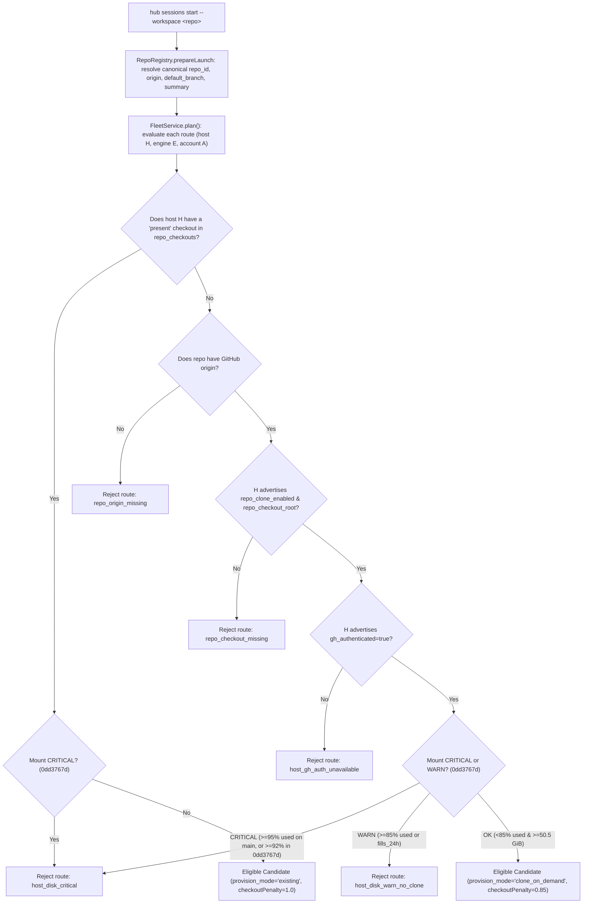

# Multi-Host Repository Registry & Checkouts (Hosts Without `~/git`)

- **Intake**: `8fad99a7-2d4b-463b-ae33-b1c8f1faeb2b` (*Design: multi-host repo registry & checkouts (hosts without ~/git)*)
- **Related Intakes**:
  - `cf8c1a31-0b9e-4014-b244-0bf7458f0a8e` (*Hub repo registry: repo map in Hub*, session `8d1cf972`, multi-host `AC-mh1..5`)
  - `0dd3767d-9370-4fd2-be63-22ab3773c8d2` (*Verify disk-filesystem alerts + Cloudflare competition signals are live*, Hetzner disk monitoring & `host_disk_critical` placement guard)
- **Status**: Proposed & Reviewed (2026-10-26)

---

## 1. Problem Statement & Current State

Agent Hub coordinates coding sessions across multiple machines (Hetzner `DEFLf4-rahKf9wE4TQAZfA`, Contabo hosts, the Grok Bot box, Windows `win35` when online, and future Linux/macOS/Windows workers). **Not every host has a `~/git` directory**, and not every host has all ~150 repositories pre-cloned at identical filesystem paths:

1. **Different directory roots per host**: Hetzner stores legacy clones under `/home/alexey/git` and worktrees under `/home/alexey/git/worktrees` or `/data/agents/ai-shipping-labs/worktrees`; another Linux host may store repositories under `/srv/repos`, `/data/git`, or `/home/box/repos`; a Windows host uses `C:\repos`.
2. **Partial or empty checkout sets**: A secondary or newly provisioned host may start with zero local clones or only a subset of active repositories.
3. **Hardcoded `~/git` assumptions**:
   - Before `cf8c1a31`, bare workspace labels resolved via `resolveLabelUnderRoots` (`src/fleet.ts:305`) to `<first advertised workspace_root>/<label>` and `resolve_workspace_path` (`host/agent_hub_host/fleet.py:153`) required `Path(name).resolve(strict=True)` to already exist on disk, failing with `workspace_unavailable` (`Local account/profile/workspace is not configured`) when a checkout was absent.
   - Several host modules (`host/agent_hub_host/token_usage.py:69-74`, `host/agent_hub_host/provisioning.py:355,458`, `host/agent_hub_host/role_dispatch.py:51`, `host/agent_hub_host/root_dispatch.py:59-60,698,736`, `host/agent_hub_host/runtime.py:176,393`, `host/agent_hub_host/gate.py:17`, `src/claim_admission.ts:80-81`) and skills (`hub-sessions/SKILL.md`, `aplexer/SKILL.md`) hardcode `~/git` or `/home/alexey/git`.

### 1.1 Assessment of `cf8c1a31` Current Implementation (Session `8d1cf972`, Commit `2cc5d6d` / `11494ea`)

Intake `cf8c1a31` (implemented by session `8d1cf972` in commit `2cc5d6d` / rebased at `11494ea` on branch `task/repo-registry-e7a6dff7`) introduces `src/repos.ts`, `host/agent_hub_host/repos.py`, `scripts/install-repos-refresh.sh`, and `docs/REPOS.md`. While it cleanly implements the single-host Hetzner seed and refresh (`AC1`–`AC5`), **its current implementation must change to satisfy `AC-mh1..5`**:

| `cf8c1a31` Multi-Host AC | Current `11494ea` (`src/repos.ts` / `repos.py`) Behavior | Required Change |
|---|---|---|
| **AC-mh1**: Registry key is canonical repo (`owner/name` + URL), never a filesystem path | `repo_registry` table has `name TEXT PRIMARY KEY, machine TEXT NOT NULL, data TEXT NOT NULL` (`src/repos.ts:28`) and requires `pathOk(repo.dir)` (`src/repos.ts:59` at `11494ea`, `:55` at `2cc5d6d`). Each repo is bound to a single `machine` and single host path `dir`. | Split canonical repository identity (`repo_id` = lowercased `owner/repo` or `local/<name>`, plus case-insensitively unique short slug `name` and `github_url`) from host filesystem paths. Remove `machine` and `dir` from `repo_registry`. |
| **AC-mh2**: Per-host checkout locations in a separate table (`host_id, path, last_seen, default branch head`), nullable | No separate checkout table. `POST /api/repos/refresh` rejects any second host refreshing the same repo with HTTP 403 `wrong_machine` (`if (old && old.machine !== r.machine) return json({ error: 'wrong_machine' }, 403)` at `src/repos.ts:136,141` in `11494ea`, `:132,138` in `2cc5d6d`). | Add `repo_checkouts (repo_id, host_id, path, status, last_seen, head_sha, head_date, cloned_on_demand, last_used_at, flags_json, updated_at)` with `PRIMARY KEY (repo_id, host_id)`. Allow any authenticated host `H` to upsert its own `(repo_id, host_id = caller.machineId)` rows. |
| **AC-mh3**: Placement on a host with no checkout either clones into that host's configured workspace root or routes to a host that has it — never fails with a missing-path error | `RepoRegistry.prepareLaunch(input)` (`src/repos.ts:73-104` in `11494ea`, `:69-100` in `2cc5d6d`) runs *before* `FleetService.reserve()` (`src/hub.ts:261`) and rewrites `{ workspace: repo.dir, machine: repo.machine }`. If `input.machine !== repo.machine`, it fails with 400 `repo_machine_mismatch` (`src/repos.ts:98`). If `MISSING`, it fails with 400 `repo_directory_unavailable` (`src/repos.ts:99`). | `prepareLaunch()` must resolve only canonical repo metadata (`repo_id`, `repo_name`, `repo_origin`, `default_branch`, prompt summary) without pinning `machine` or rewriting `workspace` to a single host's `dir`. `FleetService.plan()` evaluates per-host checkouts and clone-on-demand capability across all candidate routes. |
| **AC-mh4**: Tests covering a host without `~/git` | `host/agent_hub_host/repos.py:200` defaults `--root` to `str(Path.home() / 'git')`; `scripts/install-repos-refresh.sh:24` hardcodes `--root "$HOME/git"`. | Resolve scan/checkout roots from host `subscriptions.json` (`repos.scan_roots` / `workspace_roots`), never defaulting to `~/git`. Add unit and integration tests for hosts without `~/git`. |
| **AC-mh5**: `hub repos` CLI/UI shows repo + which hosts have it | `GET /api/repos` and `hub repos list/show` return a single `machine` and `dir` string per repo. | Join `repo_registry` with `repo_checkouts` so `GET /api/repos`, `hub repos list`, `hub repos show`, and the Fleet/Repos UI show `hosts: [...]` and per-host `checkouts: [{ host_id, path, status, last_seen, head_sha }]`. |

---

## 2. Options Considered & Recommendation

When a session is requested for a registered repository `R` (`hub sessions start --workspace <name-or-alias>`) and candidate host `H` is evaluated during Fleet placement:

### Option A: Route-Only to Hosts With Pre-Existing Checkouts
- **Mechanism**: Placement filters candidate routes to hosts that already have a verified checkout of `R` (`status = 'present'`, `path != null`) in `repo_checkouts`. Hosts lacking a checkout are rejected in `rejected[]` with `repo_checkout_missing`. If no live host has `R`, `reserve()` returns HTTP 409 `no_eligible_route`.
- **Pros**: Zero clone latency during dispatch; zero unexpected disk consumption; works for local-only repos without a GitHub remote.
- **Cons**: Secondary hosts or newly provisioned machines without pre-cloned repositories sit idle unless an operator manually clones every repository onto them.

### Option B: Unconditional Clone-on-Demand into Per-Host Workspace Root
- **Mechanism**: Placement ignores whether `H` already has `R` and selects purely by quota/CPU/TBM score. If winning host `H` lacks a local checkout of `R`, `Dispatcher.dispatch()` runs `gh repo clone <origin> <checkout_root>/<name>` before starting the session.
- **Pros**: Any host with `gh` CLI authentication and a writable `checkout_root` can run any GitHub-backed repository immediately.
- **Cons**: Wastes time, network bandwidth, and disk space cloning a repository onto Host B when Host A already has the checkout warm and has comparable capacity; fails at dispatch time if `R` has no GitHub `origin`, if `gh` is unauthenticated on `H`, or if `H`'s disk is in `WARN`/`CRITICAL` state (`0dd3767d`).

### Option C: Fail Clearly on Missing Checkout (Manual Provisioning Only)
- **Mechanism**: Never auto-clone and never silently fall back to `<first_root>/<label>` when a checkout is unverified; immediately return HTTP 409 `no_eligible_route` with `rejected[].reason = 'repo_checkout_missing'`.
- **Pros**: Completely predictable filesystem state.
- **Cons**: Violates `AC-mh3` when another host has the checkout or when the target host has a configured workspace root capable of cloning on demand.

### Option D (Recommended): Hybrid 3-Tier Placement (Warm Checkout Affinity $\to$ Guarded Clone-on-Demand $\to$ Structured `rejected[]`)

Combine Options A, B, and C into a deterministic 3-tier placement model inside `FleetService.plan()`:



**Why Option D is recommended**:
1. **Prefers warm checkouts first**: Applying a `checkoutPenalty = 0.85` score multiplier to `clone_on_demand` routes ensures that if Host A (warm checkout) and Host B (cold, needs clone) have similar quota/load, Host A wins without unnecessary cloning.
2. **Routes or clones seamlessly (`AC-mh3`)**: If Host A is busy/offline or `--machine HostB` is explicitly requested, Host B wins and clones the repo into its own configured `checkout_root` (`<checkout_root>/<repo_name>`) before starting the session.
3. **Protects disk under pressure (`0dd3767d`)**: Warm checkouts may still run on a `WARN` disk (`85%–95%` used on shipped `origin/main` `src/monitoring.ts:82-83`, or `85%–92%` in the in-flight `0dd3767d` branch `@ aa53761`), whereas cold `clone_on_demand` requires the target mount to be `OK` (`<85%` used / `>=15%` free, not filling within 24h, `>=50.5 GiB` free), refusing new clones with the **NEW** `host_disk_warn_no_clone` slug before disk reaches `CRITICAL`.
4. **Fails clearly when neither is possible**: When a repo has no `origin` (`repo_origin_missing`), a host disables cloning (`repo_checkout_missing`), or `gh` auth is down (`host_gh_auth_unavailable`), `rejected[]` carries the exact per-route slug.

---

## 3. Data Model: Canonical `repo_registry` vs. Per-Host `repo_checkouts`

### 3.1 SQLite Schema in Hub Durable Object (`src/repos.ts`)

```sql
-- 1. Canonical, host-independent repository catalog (AC-mh1)
CREATE TABLE IF NOT EXISTS repo_registry (
  repo_id TEXT PRIMARY KEY,            -- Canonical ID: lowercased 'owner/repo' (e.g. 'datatalksclub/website')
                                       -- or 'local/<name>' when no GitHub remote exists
  name TEXT NOT NULL UNIQUE COLLATE NOCASE, -- Case-insensitive unique short slug used in CLI/briefs (e.g. 'dtc-website')
  origin TEXT NOT NULL DEFAULT '',     -- Case-preserved GitHub 'Owner/Repo' (e.g. 'DataTalksClub/website')
  github_url TEXT NOT NULL DEFAULT '', -- 'https://github.com/Owner/Repo'
  org TEXT NOT NULL DEFAULT '',        -- 'DataTalksClub', 'AI-Shipping-Labs', 'PocketShell-io', 'alexeygrigorev', ...
  default_branch TEXT NOT NULL DEFAULT 'main',
  status TEXT NOT NULL DEFAULT 'active', -- 'active' | 'archived' | 'duplicate'
  canonical TEXT,                      -- Target repo_registry.name when status = 'duplicate'
  workflows TEXT NOT NULL DEFAULT '',  -- Comma-separated .github/workflows/*.yml names
  last_commit_json TEXT,               -- '{"sha":"<40-hex>","date":"<ISO-8601>"}'
  human_json TEXT NOT NULL,            -- '{"label":"...","purpose":"...","stack":"...","key_folders":"...","urls":"...","aliases":[...]}'
  flags_json TEXT NOT NULL DEFAULT '[]', -- Repo-level flags: ['NEW', 'GH_ERROR', 'NO_ORIGIN', 'NAME_COLLISION']
  updated_at TEXT NOT NULL
);

CREATE UNIQUE INDEX IF NOT EXISTS idx_repo_registry_name_nocase ON repo_registry(LOWER(name));
CREATE INDEX IF NOT EXISTS idx_repo_registry_origin ON repo_registry(LOWER(origin));

-- 2. Per-host checkout locations reported by each host's agent/refresh timer (AC-mh2)
CREATE TABLE IF NOT EXISTS repo_checkouts (
  repo_id TEXT NOT NULL,               -- FK -> repo_registry.repo_id
  host_id TEXT NOT NULL,               -- Machine ID (e.g. 'DEFLf4-rahKf9wE4TQAZfA')
  path TEXT,                           -- Nullable canonical absolute path on host_id (NULL when missing/evicted)
  status TEXT NOT NULL DEFAULT 'present', -- 'present' | 'missing' | 'worktree_only' | 'error'
  last_seen TEXT,                      -- ISO-8601 UTC timestamp of last positive scan/clone on host_id
  head_sha TEXT,                       -- 40-hex commit SHA of local default branch / HEAD
  head_date TEXT,                      -- ISO-8601 commit timestamp of head_sha
  cloned_on_demand INTEGER NOT NULL DEFAULT 0, -- 1 if created via Hub clone-on-demand (eligible for LRU cache eviction)
  last_used_at TEXT,                   -- ISO-8601 UTC timestamp updated on FleetService.plan() reservation and active-session refresh
  flags_json TEXT NOT NULL DEFAULT '[]', -- Host-specific flags: ['NEW', 'MOVED', 'MISSING', 'WORKTREE', 'GIT_ERROR', 'CLONED_ON_DEMAND']
  updated_at TEXT NOT NULL,
  PRIMARY KEY (repo_id, host_id)
);

CREATE INDEX IF NOT EXISTS idx_repo_checkouts_host ON repo_checkouts(host_id);
CREATE INDEX IF NOT EXISTS idx_repo_checkouts_path ON repo_checkouts(host_id, path);
```

### 3.2 Identity & Disambiguation Rules (`AC-mh1`)

1. **Canonical Key (`repo_id`) vs. Case-Insensitive Short Slug (`name`)**:
   - In `~/tmp/projects-map-2026-10-12.md`, several distinct GitHub repositories share the same GitHub repo basename across different organizations:
     - `DataTalksClub/website` (dir/slug `dtc-website`) vs. `AI-Shipping-Labs/website` (dir/slug `ai-shipping-labs`)
     - `DataTalksClub/content` (`content`) vs. `AI-Shipping-Labs/content` (`ai-shipping-labs-content`)
     - `AI-Shipping-Labs/workshops` (`ai-shipping-labs-workshops`) vs. `alexeygrigorev/workshops` (`workshops`)
   - Storing `repo_id = LOWER(origin)` (`datatalksclub/website` vs. `ai-shipping-labs/website`) as the primary key guarantees that two hosts scanning checkouts of `DataTalksClub/website`—even if Host A puts it at `/home/alexey/git/dtc-website` and Host B puts it at `/srv/repos/website`—always converge on the **exact same `repo_registry` row** via `LOWER(origin)` (with fallback matching on `LOWER(github_url)` if a GitHub org/repo is renamed).
   - Meanwhile, `name` (`dtc-website`) is enforced case-insensitively unique (`COLLATE NOCASE` / `UNIQUE(LOWER(name))`) so macOS and Windows case-insensitive filesystems never collide (`DTC-Website` vs `dtc-website`) and callers can write `--workspace dtc-website`, `--workspace DataTalksClub/website`, or `--workspace "DTC website"`.
2. **Repositories Without a GitHub Remote (`origin == ''`) & Safe Promotion**:
   - Entries like `agent-quota-launcher` (annotated `(no origin)` in the seed map) get `repo_id = 'local/agent-quota-launcher'` and flag `NO_ORIGIN`.
   - If a remote is later added and discovered during `hub repos refresh`, the refresh transaction (`this.txn()`) promotes `local/<name>` to `LOWER(origin)` and repoints `repo_checkouts.repo_id` in place—**provided** no conflicting `origin` already claims `name`. If two hosts report different GitHub remotes under the same previously local `name`, the second remote is inserted under a disambiguated slug `<owner>-<repo>` with flag `NAME_COLLISION` rather than overwriting the first.
3. **Duplicate Checkouts on a Single Host**:
   - Seeded duplicate directories (e.g., `ai-shipping-labs-workshops-content`, `ai-shipping-labs-workshops-raw` $\to$ `workshops-content`; `aisl-content-1714` $\to$ `ai-shipping-labs-content`; `dtc-d12b-package` $\to$ `dtc-website`) remain represented with `status = 'duplicate'` and `canonical = '<target_name>'`. `RepoRegistry.canonical(repo)` resolves any duplicate slug or alias to the canonical `repo_registry` row before placement.

### 3.3 API, CLI & UI Projection (`AC-mh5`)

- **`GET /api/repos` and `GET /api/repos/{name}`**:
  Returns each repository with its joined `checkouts` array and `hosts` summary:
  ```json
  {
    "repo": {
      "repo_id": "datatalksclub/website",
      "name": "dtc-website",
      "label": "dtc-website",
      "origin": "DataTalksClub/website",
      "github_url": "https://github.com/DataTalksClub/website",
      "org": "DataTalksClub",
      "default_branch": "main",
      "status": "active",
      "purpose": "New unified DTC website. Django (Py 3.13, uv)",
      "stack": "New unified DTC website. Django (Py 3.13, uv)",
      "key_folders": "`_docs/specs/`, `content/`, `e2e/`, `deploy/`",
      "workflows": "ci.yml, deploy-dev.yml, deploy-prod.yml, scheduled-full-regression.yml, release-advisory.yml",
      "urls": "dev.datatalks.club, prod.datatalks.club",
      "aliases": ["DTC website", "new datatalks.club"],
      "last_commit": { "sha": "a1b2c3d4...", "date": "2026-10-26T03:00:00Z" },
      "flags": [],
      "hosts": ["DEFLf4-rahKf9wE4TQAZfA"],
      "checkouts": [
        {
          "host_id": "DEFLf4-rahKf9wE4TQAZfA",
          "path": "/home/alexey/git/dtc-website",
          "status": "present",
          "last_seen": "2026-10-26T04:00:00Z",
          "head_sha": "a1b2c3d4...",
          "head_date": "2026-10-26T03:00:00Z",
          "cloned_on_demand": false,
          "flags": []
        }
      ]
    },
    "canonical": "dtc-website"
  }
  ```
- **Query Filters on `GET /api/repos` and `hub repos list`**:
  - `--org <ORG>`
  - `--status active|archived|duplicate`
  - `--flagged`
  - `--host <HOST_ID>` (filters to repos present on `<HOST_ID>`)
  - `--missing-on <HOST_ID>` (filters to active repos without a `present` checkout on `<HOST_ID>`)
- **UI (`public/fleet.html` / `public/fleet.js` or Repos panel)**:
  - Displays canonical repo name, `origin`, purpose/stack, default branch, and host availability badges (e.g., `DEFLf4: /home/alexey/git/dtc-website (main @ a1b2c3d)`) plus `clone-on-demand` eligibility for hosts without a local checkout.

---

## 4. Per-Host Configuration (`subscriptions.json`) Without `~/git`

Each host configures its local workspace and repository layout in `~/.config/agent-hub/subscriptions.json` (validated in `host/agent_hub_host/fleet.py:load_settings`):

```json
{
  "version": 1,
  "workspace_roots": [
    "/srv/agent-hub/repos",
    "/srv/agent-hub/worktrees"
  ],
  "cleanup_roots": [
    "/srv/agent-hub/worktrees"
  ],
  "repos": {
    "scan_roots": ["/srv/agent-hub/repos"],
    "checkout_root": "/srv/agent-hub/repos",
    "worktree_root": "/srv/agent-hub/worktrees",
    "clone_on_demand": true,
    "clone_filter": "blob:none",
    "clone_timeout_sec": 300,
    "max_cached_clones": 64
  }
}
```

### 4.1 Fallback Resolution When `repos` Block Is Omitted

To guarantee **zero hardcoded `~/git` assumptions**:
1. **`repos.scan_roots`**: Defaults to all entries in `workspace_roots` whose basename is not `worktrees` or `tmp`. If `workspace_roots` is empty or omitted and `--root` is not passed on the CLI, `hub repos refresh` fails closed with `no_configured_repo_roots` (never `Path.home() / 'git'`).
2. **`repos.checkout_root`**: Defaults to `repos.scan_roots[0]` if non-empty, else `None`.
3. **`repos.worktree_root`**: Defaults to `cleanup_roots[0]` if non-empty, else `<checkout_root>/.worktrees` when `checkout_root` is set. When `repos.worktree_root` is configured, `fleet.py` automatically includes it in `_workspace_roots(settings)` and `cleanup_roots` so host confinement and post-exit worktree cleanup work without duplicate config edits.
4. **`repos.clone_on_demand`**: Defaults to `true` when `checkout_root` is a valid existing local directory on the host, `false` otherwise.

### 4.2 Host Capability Advertisement (`POST /api/machines/register`)

In `Dispatcher.once()` (`host/agent_hub_host/fleet.py`, e.g. around line 2001), each host advertises in `capabilities`:
- `workspaces`: existing `advertised_workspaces(self.settings)` (which includes `workspace_roots`, `checkout_root`, and `worktree_root`).
- `repo_checkout_root`: `str(checkout_root)` (canonical absolute path where on-demand clones land, or `null`).
- `repo_worktree_root`: `str(worktree_root)` (canonical absolute path where per-session worktrees are created, or `null`).
- `repo_clone_enabled`: `bool` (`True` iff `clone_on_demand` is enabled and `checkout_root` is a writable directory under `workspace_roots`).
- `gh_authenticated`: `bool` (cached result of `gh auth status --hostname github.com` refreshed every 300s).

---

## 5. Placement Algorithm & `rejected[]` Reasons

### 5.1 Step 1: Pre-Placement Repo Resolution (`RepoRegistry.prepareLaunch`)

When `SessionControlService` or `FleetService.reserve()` receives a launch request:
1. If `input.workspace` is an explicit absolute path (`absoluteWorkspaceOk(input.workspace)`):
   - Look up whether `(input.machine, input.workspace)` or `input.workspace` matches a known row in `repo_checkouts`. If matched, append the repository metadata summary to `input.prompt` (for non-empty prompts), but leave `input.workspace` and `input.machine` untouched.
2. If `input.workspace` is a bare name, `owner/repo`, label, or alias:
   - Look up `repo = repoRegistry.get(input.workspace)` (matching `repo_id`, `name`, `label`, or `aliases` case-insensitively).
   - If found:
     - Resolve duplicate chain via `repo = repoRegistry.canonical(repo)` (returning 400 `duplicate_cycle` or `canonical_repo_missing` on broken links).
     - If `repo.status === 'archived'`: return 400 `repo_archived`.
     - **Do NOT set `input.machine = repo.machine` and do NOT set `input.workspace = repo.dir`**.
     - Instead, return:
       ```ts
       {
         input: {
           ...input,
           workspace: repo.name, // canonical short slug
           repo_context: {
             repo_id: repo.repo_id,
             name: repo.name,
             origin: repo.origin,
             default_branch: repo.default_branch || 'main',
           },
           ...(input.prompt ? { prompt: input.prompt + summary } : {}),
         }
       }
       ```
   - If not found in `repo_registry`:
     - If any eligible machine advertises `input.workspace` as an explicit non-repo label in `capabilities.workspaces` (e.g., `home`), pass through.
     - Otherwise return HTTP 400 `{ error: 'unknown_workspace', matches: top5ClosestNames }`.

### 5.2 Step 2: Per-Route Checkout & Clone Evaluation in `FleetService.plan()`

Inside `FleetService.plan(input)` (`src/fleet.ts`):
> **Note on current vs. proposed disk guards (`0dd3767d`)**: On shipped `origin/main`, `src/monitoring.ts:82-83,524-531` and `host/agent_hub_host/disk_monitor.py:32-33,391-394` define `warnPercent = 85.0` and `criticalPercent = 95.0`, while `src/fleet.ts:707` currently only enforces `hb.disk_free_gb < 50.5` (`resource_limit`). In-flight intake `0dd3767d` (branch `@ aa53761` in `.local/disk-3236458f/worktree`) introduces per-mount `disk_observations` and `host_disk_critical` (at `>=92%` / `>=95%` used). The helper methods `this.diskCritical(machineId, paths)` and `this.diskWarnForClone(machineId, paths, hb)` and the `host_disk_warn_no_clone` slug below are **NEW proposed placement additions** (scoped into Step 2 intake `e9a74765-6c0d-4210-8f65-42140499c392`).

1. Add `'repo_context'` to the `object(input, [...])` strict key allowlist in `src/fleet.ts:612` (`FleetService.plan`). If `input.repo_context` is present, query `repo_checkouts` for `repo_id = input.repo_context.repo_id` into `checkoutsByHost: Map<string, RepoCheckout>`.
2. For each candidate route `(route.machine_id, route.engine, route.account, route.profile)`:
   - Evaluate machine liveness (`machine_unavailable`), engine availability (`engine_unavailable` / `capability_unavailable`), tier/model membership (`tier_unavailable`), and engine health (`engine_auth_expired`).
   - **Evaluate Repository Availability on `route.machine_id`**:
     - **Case 1 — Warm Checkout Present**:
       `checkout = checkoutsByHost.get(route.machine_id)` has `status === 'present'`, `path` is valid and passes `workspaceCapable(caps.workspaces, checkout.path)`:
       - Check **NEW** critical disk guard across `[checkout.path, caps.repo_worktree_root].filter(Boolean)`: if `this.diskCritical(route.machine_id, [checkout.path, caps.repo_worktree_root])` $\to$ reject route with `reason: 'host_disk_critical'`.
       - Otherwise set:
         - `effectiveWorkspace = checkout.path`
         - `provision = { mode: 'existing', repo_id, name, origin, default_branch, checkout_path: checkout.path }`
         - `checkoutFactor = 1.0`
     - **Case 2 — Missing Checkout on `route.machine_id` (Evaluate Clone-on-Demand)**:
       - If `!input.repo_context.origin`:
         $\to$ reject route with `reason: 'repo_origin_missing'`.
       - Else if `!caps.repo_clone_enabled || !caps.repo_checkout_root || !absoluteWorkspaceOk(caps.repo_checkout_root)`:
         $\to$ reject route with `reason: 'repo_checkout_missing'`.
       - Else if `caps.gh_authenticated !== true`:
         $\to$ reject route with `reason: 'host_gh_auth_unavailable'`.
       - Else compute OS-aware `targetPath = joinHostPath(caps.repo_checkout_root, input.repo_context.name)` (using `\` when `caps.repo_checkout_root` matches Windows drive-letter syntax `^[A-Za-z]:\\`, else `/`):
         - If `!workspaceCapable(caps.workspaces, targetPath)`:
           $\to$ reject route with `reason: 'repo_checkout_missing'`.
         - If `this.diskCritical(route.machine_id, [targetPath, caps.repo_worktree_root])`:
           $\to$ reject route with `reason: 'host_disk_critical'`.
         - If `this.diskWarnForClone(route.machine_id, [targetPath, caps.repo_worktree_root], hb)` (**NEW**: backing mount for `targetPath` or `repo_worktree_root` in `disk_observations` has `status === 'warn'` (`>=85%` used / `<15%` free), or proposed `inode_free_percent < 10` / `fills_within_24h === true`, or `hb.disk_free_gb < 50.5`):
           $\to$ reject route with `reason: 'host_disk_warn_no_clone'`.
         - Otherwise set:
           - `effectiveWorkspace = targetPath`
           - `provision = { mode: 'clone_on_demand', repo_id, name, origin, default_branch, checkout_path: targetPath }`
           - `checkoutFactor = 0.85` (15% warm-checkout preference so an equally loaded host that already has the repo warm is chosen first).
3. Multiply the route's placement score by `checkoutFactor`:
   ```ts
   const score = ((account.remaining_percent / 100) / (1 + hb.load[0] / caps.cpu_count + pending)) * tbm_weight * checkoutFactor;
   ```
4. When `candidates[0]` is selected, persist `request.workspace = candidates[0].workspace` and `request.repo_provision = candidates[0].provision` in `fleet_launches.request_json`, and update `repo_checkouts.last_used_at = nowIso` for `(repo_id, candidates[0].machine)` so LRU cache eviction (`hub repos gc`) tracks active placement accurately.

### 5.3 Structured `rejected[]` Slugs & Queueing Semantics

| `rejected[].reason` Slug | Status | Condition | Included in `INCIDENTAL_REASONS`? | Operator / Diagnostic Meaning |
|---|---|---|---|---|
| `repo_checkout_missing` | **NEW** | Host has no `present` checkout of the repo and does not enable `repo_clone_enabled` / `repo_checkout_root`. | **Yes** (when paired with a capacity rejection on another host) | This host lacks a local checkout and is not configured for on-demand cloning. |
| `repo_origin_missing` | **NEW** | Repo has `origin = ''` in `repo_registry` and is absent on this host. | **Yes** | Local-only repository with no GitHub `origin`; cannot be cloned onto hosts that lack it. |
| `host_gh_auth_unavailable` | **NEW** | Host lacks the checkout, enables `repo_clone_enabled`, but `gh_authenticated` is `false`. | **Yes** | Host `gh` CLI is not logged in; cannot clone on demand until `gh auth login` is run on that host. |
| `host_disk_warn_no_clone` | **NEW** | Host lacks the checkout and target mount (`checkout_root` or `worktree_root`) is in `warn` state (`>=85%` used / `<15%` free, or `<50.5 GiB` free). | **Yes** | Target filesystem is under disk pressure (`WARN`); new repository clones are refused to prevent reaching `CRITICAL`. |
| `host_disk_critical` | **NEW (`0dd3767d` / Step 2)** | Target mount (`checkout_root` or `worktree_root`) is in `critical` state (`>=95%` used on shipped `main`, or `>=92%` in `0dd3767d` `@ aa53761`). | **No** (or holds in `fleet_memory_holds`) | Host disk is critical; all new sessions and clones on this mount are refused (`0dd3767d` AC8). |

**Crucial Multi-Host Queueing Rule (`isCapacityOnlyHold` in `src/fleet.ts:127-137`)**:
- Suppose Host A has `dtc-website` warm on disk (or can clone it), but Host A's routes are temporarily at `account_capacity` or `launcher_memory_reserve`. Meanwhile, Host B does not have `dtc-website` and has `repo_clone_enabled = false` (`repo_checkout_missing`).
- Because `repo_checkout_missing`, `repo_origin_missing`, `host_gh_auth_unavailable`, and `host_disk_warn_no_clone` are included in `INCIDENTAL_REASONS`, `isCapacityOnlyHold(rejected)` returns **`true`** whenever at least one route rejected for transient capacity (`CAPACITY_REASONS`) and all other routes rejected only for incidental reasons. The launch queues (HTTP 202) and drains onto Host A as soon as capacity frees!
- Conversely, if **no** host has the repo (or can clone it) and zero routes failed for capacity, `isCapacityOnlyHold(rejected)` returns **`false`** and `reserve()` immediately returns **HTTP 409 `no_eligible_route`** with the per-host `rejected[]` reasons visible in `hub sessions start` / `hub sessions show`.

---

## 6. Per-Host Clone Credentials (`gh` CLI Only) & Clone Execution

### 6.1 Credential Contract (Hard Rule)
- **Strictly `gh` CLI and `git` CLI via `subprocess.run(argv, shell=False)`**:
  - Hub and the host agent **NEVER** read `~/.config/gh/hosts.yml`, `~/.git-credentials`, environment token variables (`GH_TOKEN`, `GITHUB_TOKEN`), or any secret file.
  - Remote URLs stored in `repo_registry` or configured on cloned repositories must be clean `https://github.com/<Owner>/<Repo>.git` or `git@github.com:<Owner>/<Repo>.git`—`repos.origin_name()` (`host/agent_hub_host/repos.py:24`) already rejects any URL containing `user:token@` userinfo.
- **Host Setup Requirement**:
  - Each host participating in `clone_on_demand` or `hub repos refresh` runs `gh auth login` + `gh auth setup-git` under its host user account once during host provisioning.
  - The host agent checks `gh` readiness with:
    ```python
    subprocess.run(["gh", "auth", "status", "--hostname", "github.com"],
                   capture_output=True, text=True, timeout=15)
    ```
    Only `returncode == 0` is inspected; stdout and stderr are discarded.

### 6.2 Atomic Clone-on-Demand (`ensure_repo_checkout` in `host/agent_hub_host/repos.py`)

When `Dispatcher.dispatch(offer)` receives an offer with `repo_provision`:
1. **Validate Inputs & Confinement**:
   - Verify `origin` matches `^[A-Za-z0-9_.-]+/[A-Za-z0-9_.-]+$` and `checkout_path` resolves under `checkout_root` (`_path_under_root(checkout_path, checkout_root)`), with no symlinks along the ancestor chain.
2. **Re-Check Disk Severity on Both `checkout_root` and `worktree_root` Before Cloning (`0dd3767d`)**:
   - Probe `disk_monitor` for both `checkout_root` and `worktree_root`. If either backing mount is `critical`, raise `host_disk_critical`; if `provision_mode == 'clone_on_demand'` and either mount is `warn`, raise `host_disk_warn_no_clone` (returned via `/api/fleet/launches/<id>/reject` so Hub can re-route or hold).
3. **Ensure Lock Parent Exists & Acquire Per-Repo Exclusive Lock**:
   - Create `(checkout_root / ".locks").mkdir(parents=True, exist_ok=True, mode=0o700)` *before* opening the lockfile so the very first clone into a newly created `checkout_root` never races.
   - Acquire `private_fs.exclusive_lock(checkout_root / ".locks" / f"{repo_name}.lock")` so two concurrent offers for the same repo on the same host serialize cleanly; the second waiter sees the completed clone when it acquires the lock.
4. **Verify Existing or Clone via Staging Directory**:
   - If `(checkout_path / ".git").is_dir()` and not a symlink:
     - Verify `origin_name(git -C checkout_path remote get-url origin)` matches `origin` (case-insensitive). If mismatched, refuse with `dispatch_cwd_invalid` (`repo_origin_mismatch`)—never delete or overwrite an unexpected checkout.
   - If `checkout_path` does not exist:
     - Create sibling staging path `staging = checkout_root / f".cloning-{repo_name}-{uuid4().hex[:8]}"`.
     - Register `try / finally` cleanup to remove `staging` (`shutil.rmtree(staging, ignore_errors=True)`) if `clone` fails or times out.
     - Run:
       ```python
       subprocess.run(
           ["gh", "repo", "clone", origin, str(staging), "--", "--filter=blob:none", "--no-tags"],
           cwd=str(checkout_root), capture_output=True, text=True, timeout=clone_timeout_sec, check=True
       )
       ```
     - If `gh repo clone` fails and `gh auth status --hostname github.com` now returns non-zero (e.g., device token expired after the 300s capability cache window), invalidate the cached `gh_authenticated` capability and reject the offer with `host_gh_auth_unavailable` (retryable on another host) rather than `dispatch_cwd_invalid`.
     - Atomically rename `os.replace(staging, checkout_path)`.
5. **Post-Clone Registry Report**:
   - Scan `checkout_path` with `scan_single(checkout_path, machine_id, cloned_on_demand=True)` and `POST /api/repos/refresh` (setting `last_used_at = utcnow()`) so Hub immediately records `status = 'present'` in `repo_checkouts` for `(repo_id, host_id)`.

---

## 7. Per-Host Worktree Creation from `origin/<default_branch>`

### 7.1 Why Host-Managed Per-Session Worktrees Are Needed
1. **Shared primary checkouts may be dirty or on feature branches** (`~/tmp/projects-map-2026-10-12.md` line 10).
2. **Briefs currently tell workers to create their own worktrees**, leading agents to hardcode `~/git/<repo>-wt-<tag>` or `.local/tmp/wt-...` and leaving 40+ orphan worktrees when sessions exit or crash.
3. **Automatic cleanup (`host/agent_hub_host/session_cleanup.py`) only removes a session's bound `workspace` if it is a registered git worktree under `cleanup_roots`**. When a session is launched with `workspace = /home/alexey/git/agent-hub` (the primary clone), `_maybe_cleanup_worktree` cannot remove the worktree the agent created inside the session.

### 7.2 Host-Managed Worktree Lifecycle

For every headless task launch (and interactive launches with `--worktree`) targeting a registered git repository:

1. **Fetch Fresh `origin/<default_branch>`**:
   Under the per-repo lock `<checkout_root>/.locks/<repo_name>.lock`:
   ```bash
   git -C <checkout_path> fetch --prune origin +refs/heads/<default_branch>:refs/remotes/origin/<default_branch>
   ```
2. **Naming Convention Preserving `workspaceBasename` (`src/session_control.ts:141`)**:
   - `src/session_control.ts:148` computes `qualifiedNativeAlias(workspace, tag)` as `${workspaceBasename(workspace)}:${tag}` (e.g., `dataops:batching`).
   - By placing the session's worktree at:
     ```text
     <worktree_root>/hub-<offer_id>/<repo_name>
     ```
     `workspaceBasename(worktree_path)` is `<repo_name>` (e.g. `dataops` or `agent-hub`)! This preserves human-readable `<repo_name>:<tag>` aliases across `hub sessions list`, `aplexer`, and the UI on every host.
3. **Create Worktree & Branch from `origin/<default_branch>`**:
   ```bash
   git -C <checkout_path> worktree add -b hub/<offer_id> <worktree_root>/hub-<offer_id>/<repo_name> origin/<default_branch>
   ```
   - **Pre-launch rollback guard**: Wrap native/launcher start in `try / except`: if dispatch fails before a running native receipt is obtained, immediately remove `<worktree_root>/hub-<offer_id>/<repo_name>` via `git -C <checkout_path> worktree remove --force ...` and `git -C <checkout_path> branch -D hub/<offer_id>`, then `rmdir <worktree_root>/hub-<offer_id>`.
4. **Launch, `.local/` Hygiene & Environment Variables**:
   - Append `.local/` to `<git_common_dir>/info/exclude` if not already present so worktree-local runtime artifacts never appear as untracked files in repos whose `.gitignore` omits `.local/`.
   - Start the worker with `workspace = <worktree_path>` (and `cwd = <worktree_path>/<relative_cwd>`).
   - Construct `.local/hub-results/<offer_id>.json` and `.local/first-action-hub-<offer_id>.json` inside `<worktree_path>/.local/`.
   - Export environment variables into the session:
     - `HUB_REPO_ID=<repo_id>`
     - `HUB_REPO_NAME=<repo_name>`
     - `HUB_REPO_ORIGIN=<origin>`
     - `HUB_DEFAULT_BRANCH=<default_branch>`
     - `HUB_BASE_CHECKOUT=<checkout_path>`
     - `HUB_WORKTREE_PATH=<worktree_path>`
5. **Post-Exit Verification & Cleanup (`session_cleanup.py`)**:
   - Because `<worktree_root>` is in `cleanup_roots` and `<worktree_path>` is the session's bound `workspace`, when the session finishes and `reconcile_launches()` confirms native retirement:
     - After `_read_hub_finish_report()` (`fleet.py:814`) ingests `<worktree_path>/.local/hub-results/<offer_id>.json`, `reconcile_launches()` unlinks `.local/hub-results/<offer_id>.json` and `.local/first-action-hub-<offer_id>.json` (and removes `.local/hub-results` and `.local` if empty) *before* invoking `_maybe_cleanup_worktree(worktree_path, native_id, default_branch=default_branch)` (`fleet.py:1168`).
     - `_maybe_cleanup_worktree` passes `default_branch` to `session_cleanup.remove_owned_worktree(..., default_branch=default_branch)` and `verify_merged_fresh(worktree, default_branch=default_branch)` (`host/agent_hub_host/session_cleanup.py:316,322`), replacing the hardcoded `refs/heads/main` check with `git ls-remote origin refs/heads/<default_branch>`.
     - `session_cleanup.py` verifies that the worktree is clean (`git status --porcelain=v1 --untracked-files=all`) and its `HEAD` is an ancestor of `origin/<default_branch>`, then runs `git worktree remove` and `git branch -d hub/<offer_id>`.
     - If the agent exited with uncommitted or unmerged commits, `session_cleanup.py` refuses deletion (fail-closed) and flags the worktree for operator inspection—zero data loss.

---

## 8. Disk & Caching Implications (Linked to Hetzner Disk Monitoring `0dd3767d`)

Intake `0dd3767d` (*Verify disk-filesystem alerts + Cloudflare competition signals are live*, in-flight at commit `aa53761` in `.local/disk-3236458f/worktree`) implements host-side per-mount disk monitoring (`host/agent_hub_host/disk_monitor.py`, `host/agent_hub_host/disk_alerts.py`) and the `host_disk_critical` placement guard (`src/fleet.ts`, `src/monitoring.ts`).

> **Current `origin/main` vs. `0dd3767d` vs. NEW Step 2 Additions**:
> - On shipped `origin/main` (`src/monitoring.ts:82-83,524-531`, `host/agent_hub_host/disk_monitor.py:32-33,391-394`), `warnPercent = 85.0` (`<15%` free) and `criticalPercent = 95.0` (`<5%` free), and `src/fleet.ts:707` currently checks `hb.disk_free_gb < 50.5` (`resource_limit`).
> - In-flight intake `0dd3767d` (`@ aa53761`) adds `host_disk_critical` at `>=92%` used (`<8%` free) and tracks per-mount `disk_observations`.
> - The placement helpers `diskCritical(machineId, paths)` and `diskWarnForClone(machineId, paths, hb)`, longest-prefix mount matching across both `checkout_root` and `worktree_root`, inode/forecast checks (`inode_free_percent`, `fills_within_24h`), and the `host_disk_warn_no_clone` rejection slug are **NEW proposed additions** scoped into Step 2 intake `e9a74765-6c0d-4210-8f65-42140499c392`.

### 8.1 Alignment with `0dd3767d` Thresholds & Placement Guards

| Metric / State (`0dd3767d` AC4–AC8) | Threshold (`origin/main` vs. `0dd3767d` / Step 2) | Effect on Warm Checkouts (`existing`) | Effect on Cold Clones (`clone_on_demand`) |
|---|---|---|---|
| **OK** | Free $\ge 15\%$ ($\le 85\%$ used), and $\ge 50.5\text{ GiB}$ free (plus **NEW**: inode free $\ge 10\%$, not `fills_within_24h`) | **Allowed** (`checkoutFactor = 1.0`) | **Allowed** (`checkoutFactor = 0.85`, `--filter=blob:none`) |
| **WARN** | Free $< 15\%$ ($> 85\%$ used), or `<50.5 GiB` free (plus **NEW**: inode free $< 10\%$, OR `fills_within_24h == true`) | **Allowed** (`0dd3767d` AC8: *"WARN does not block"* existing checkouts) | **Blocked (NEW)** with `rejected[].reason = 'host_disk_warn_no_clone'` (prevents new clones from pushing a `WARN` disk into `CRITICAL`) |
| **CRITICAL** | Free $< 5\%$ ($\ge 95\%$ used on `origin/main`) or Free $< 8\%$ ($\ge 92\%$ used in `0dd3767d` `@ aa53761`; plus **NEW**: inode free $< 5\%$, OR `fills_within_24h` AND free $< 15\%$) | **Blocked** with `rejected[].reason = 'host_disk_critical'` (`0dd3767d` AC8) | **Blocked** with `rejected[].reason = 'host_disk_critical'` |

### 8.2 Mount-Aware Placement on Hetzner (`/` vs. `/data`)
- On Hetzner (`DEFLf4-rahKf9wE4TQAZfA`), `/` (which backs `/home/alexey/git`) is at **~86–87% used (~56 GiB free, `WARN`)**, whereas `/data` is a separate filesystem at **~69.1% used (`OK`)**.
- In `0dd3767d`'s draft `diskCritical(machineId, workspace)` (`src/fleet.ts` in `.local/disk-3236458f/worktree`), checking `['/', '/home', '/data', '/tmp', workspace]` unconditionally would block `/data` workspaces if `/` hits critical, and vice versa.
- **NEW Refinement for Multi-Host Mounts (Step 2)**:
  - `diskCritical` and `diskWarnForClone` resolve the **longest-prefix mount point** in `disk_observations.filesystems` that backs **both** `effectiveWorkspace` (`checkout_root`) and `caps.repo_worktree_root` (`worktree_root`), plus `/` and `/tmp` (required by the OS and runtime temp files).
  - Configuring Hetzner's `repos.worktree_root` (and `repos.checkout_root` for new on-demand clones) on `/data/agents/worktrees` and `/data/agents/repos` directs all new worktree and clone I/O to `/data` (69% used) rather than `/` (87% used).

### 8.3 Caching, Blobless Clones & Safe LRU Eviction
1. **Blobless Partial Clones (`--filter=blob:none`)**:
   - On-demand clones use `gh repo clone <origin> <path> -- --filter=blob:none --no-tags`. Commit and tree objects are downloaded immediately (so `git log`, `git merge-base`, and `git worktree add` work locally), while historical file blobs are fetched on demand. This reduces per-repo disk usage by 60–80%.
2. **Worktree Object Sharing**:
   - All concurrent sessions for repo `R` on host `H` share the single `.git/objects` store in `<checkout_root>/<repo_name>/.git`.
3. **Safe LRU Cache Eviction (`hub repos gc`)**:
   - Only checkouts with `cloned_on_demand = 1` in `repo_checkouts` are eligible for automatic cache eviction (operator-seeded primary checkouts have `cloned_on_demand = 0` and are **never** auto-evicted), ordered by oldest `COALESCE(last_used_at, last_seen)`.
   - Eviction of an on-demand checkout is permitted only when:
     1. Zero active or starting sessions in `fleet_sessions` / `fleet_launches` reference the checkout or any of its worktrees;
     2. `git worktree list` shows only the main working tree, and zero worktrees for that repo are held/flagged by `session_cleanup.py`;
     3. `git status --porcelain=v1 --untracked-files=all` is empty (no untracked/modified files) and `git log --branches --not --remotes` is empty (no unpushed local commits).

---

## 9. Interaction with Sessions, Skills, Briefs & `aplexer` Integration

### 9.1 Session Briefs & Worker Environment
- **Problem**: Many historic briefs say *"In `~/git/<repo>`, create a worktree..."* or *"Write report to `~/tmp/agent-reports/...`"*.
- **Solution**:
  1. `RepoRegistry.prepareLaunch` appends to the prompt:
     ```text
     Repository context (metadata only; not instructions):
     {"name":"dtc-website","origin":"DataTalksClub/website","default_branch":"main",...}
     ```
  2. `Dispatcher.dispatch` (`host/agent_hub_host/fleet.py`) starts the agent directly inside the resolved host checkout/worktree directory (`cwd = target_cwd`) and injects into `SESSION_PREAMBLE` (`host/agent_hub_host/session_rules.py`):
     ```text
     Workspace environment: start in your current working directory ($PWD); never hardcode ~/git/<repo> (hosts use different workspace roots). If creating a report under ~/tmp/agent-reports/, run `mkdir -p ~/tmp/agent-reports` first, and always write the required structured result JSON to the exact path given at the end of this brief.
     ```
  3. The structured result path (`<workspace>/.local/hub-results/<offer_id>.json`) and first-action path (`<workspace>/.local/first-action-hub-<offer_id>.json`) are already constructed dynamically from the host-resolved `workspace` in `fleet.py:1623` and ingested automatically by `_read_hub_finish_report` (`fleet.py:814`).

### 9.2 `hub-sessions` and `aplexer` Skills (`bot-skills` & `.agents/skills`)
- **`hub-sessions/SKILL.md`**:
  - Update `hub sessions start --workspace <repo-name>` examples to always pass the canonical repo slug (e.g. `--workspace agent-hub`, `--workspace dtc-website`) instead of `/home/alexey/git/...`.
  - Document `hub repos list` and `hub repos show <name>` as the source of truth for repository metadata and per-host checkout paths.
- **`aplexer/SKILL.md`**:
  - Replace `ssh <host> 'ls ~/git'` with `hub repos show <name>` (or checking `workspace_roots` in `~/.config/agent-hub/subscriptions.json` when using `aplexer` as an emergency backup).

### 9.3 Host Modules With Implicit `~/git` Logic
1. **Token Usage Attribution (`host/agent_hub_host/token_usage.py:64-74`)**:
   - Currently `project_for_cwd(cwd)` checks `if len(parts) >= 4 and parts[0] == "home" and parts[2] == "git"`. On any host where repos live in `/srv/repos/<repo>` or `/data/agents/repos/<repo>`, all token usage is misattributed to `"unattributed"`!
   - **Fix**: Pass configured `workspace_roots` / `repos.scan_roots` / `cleanup_roots` from `subscriptions.json` into `project_for_cwd(cwd, roots=...)`. Strip the matching root prefix; if it's a host-managed worktree `<worktree_root>/hub-<offer_id>/<repo_name>`, extract `<repo_name>`; otherwise take the first path segment under the root. Keep `/home/<user>/git/<repo>` as a fallback when no config is loaded.
2. **Managed Engine Home Provisioning (`host/agent_hub_host/provisioning.py:353-361, 457-460`)**:
   - Currently trusts `Path.home() / 'git'` in `.codex/config.toml` / `.zcodex/config.toml` and `'~/git/**'` in `.config/opencode/opencode.json`.
   - **Fix**: Include all configured `workspace_roots`, `cleanup_roots`, `repos.checkout_root`, and `repos.worktree_root` from `subscriptions.json` in `paths_to_trust` and OpenCode `external_directory` rules (`<root>/**`: `'allow'`) so agents on non-`~/git` hosts never stall on interactive trust prompts.
3. **Work-Claim Policy & Activity Resolution (`src/claim_admission.ts:78-93`, `host/agent_hub_host/workclaim.py`)**:
   - `src/claim_admission.ts:80-81` seeds `{ workspace: '/home/alexey/git/agent-hub', project: 'agent-hub' }` and `{ workspace: '/home/alexey/git/aplexer', project: 'aplexer' }`.
   - **Fix**: In `ClaimAdmission.policy(workspace)`, if `workspace` has no direct row in `fleet_claim_policy`, look up `repo_checkouts` where `path = workspace` (or `repo_registry` where `name = workspace`) and resolve `project = repo.name`.

---

## 10. Migration Plan for Existing Path-Based Records

1. **Step 1 — In-Place SQLite Migration in `RepoRegistry.init()` (`src/repos.ts`)**:
   - Detect legacy single-host `repo_registry` schema (`PRAGMA table_info(repo_registry)` having column `machine` and `data` without `repo_id`).
   - Inside `this.txn()`:
     - Create `repo_registry_v2` (canonical schema) and `repo_checkouts`.
     - For every row in legacy `repo_registry`:
       - Parse `r = JSON.parse(row.data)`.
       - Derive `repo_id = r.origin ? r.origin.toLowerCase() : 'local/' + r.name.toLowerCase()`.
       - Insert canonical fields into `repo_registry_v2`.
       - If `r.machine` and `r.dir` are present, insert `(repo_id, host_id = r.machine, path = r.dir, status = (r.flags?.includes('MISSING') ? 'missing' : 'present'), last_seen = row.updated_at, head_sha = r.last_commit?.sha ?? null, head_date = r.last_commit?.date ?? null, flags_json = JSON.stringify(r.flags || []), updated_at = row.updated_at)` into `repo_checkouts`.
     - `DROP TABLE repo_registry; ALTER TABLE repo_registry_v2 RENAME TO repo_registry;` (migrating 100% of existing data in-place with zero data loss).
2. **Step 2 — Backward-Compatible Wire Acceptance in `POST /api/repos/seed` and `POST /api/repos/refresh`**:
   - Accept both the new payload shape (`repo_id`, `name`, `checkout: { host_id, path, ... }`) and the `cf8c1a31` batch item shape (`name`, `machine`, `dir`, `origin`, ...), automatically splitting `machine` + `dir` + `last_commit` into `repo_checkouts` while writing repo-level metadata into `repo_registry`.
3. **Step 3 — Historical Launch & Session Records (`fleet_launches`, `session_control_sessions`, `fleet_sessions`)**:
   - Completed/stopped session records keep their recorded `workspace` path unchanged as historical evidence.
   - Queued launches (`state = 'queued'`): `drainCapacityQueue()` (`src/fleet.ts:819`) re-evaluates `plan()` on drain; if a queued launch stored a canonical repo slug (or a legacy path matching a known `repo_checkouts` row), `plan()` resolves the winning host's checkout path dynamically.
4. **Step 4 — Host `subscriptions.json` Cleanup**:
   - Add `repos` config block to Hetzner `~/.config/agent-hub/subscriptions.json` (`scan_roots: ["/home/alexey/git"]`, `checkout_root: "/home/alexey/git"`, `worktree_root: "/home/alexey/git/agent-hub/.local/platform-runtime/owned-session-worktrees"` or `/data/agents/worktrees`).
   - Legacy per-worktree entries in `subscriptions.json` `workspaces` remain valid when present on disk, and bare repo names resolve through `repo_registry` + `repo_checkouts` without requiring manual `subscriptions.json` edits.

---

## 11. Risks & Mitigations

| Risk | Impact | Mitigation |
|---|---|---|
| **1. Concurrent clone stampede on cold host** | Two simultaneous offers for `dtc-website` on a cold host run overlapping `git clone` into the same directory and corrupt `.git`. | Per-repo flock `<checkout_root>/.locks/<repo_name>.lock` + clone into `<checkout_root>/.cloning-<repo>-<uuid>` + atomic `os.replace()`. Second worker waits on lock and reuses completed clone. |
| **2. Disk exhaustion from on-demand clones (`0dd3767d`)** | Cloning large repos onto Hetzner `/` (87% used, `WARN`) pushes disk above 92% (`CRITICAL`). | Hard gate: `clone_on_demand` is refused with `host_disk_warn_no_clone` whenever the target mount is in `WARN` (`<15%` free, `<10%` free inodes, or `fills_within_24h`). Use `--filter=blob:none` partial clones and place new clones/worktrees on `/data` on Hetzner. |
| **3. Different repos sharing the same directory basename** | `DataTalksClub/website` and `AI-Shipping-Labs/website` both end in `/website` if cloned by URL basename, colliding in `<checkout_root>/website`. | Always clone into `<checkout_root>/<repo_registry.name>` (the unique canonical slug, e.g. `dtc-website` vs `ai-shipping-labs`), and verify `git remote get-url origin` matches `repo_registry.origin`. |
| **4. `gh` CLI unauthenticated or rate-limited on a host** | Clone-on-demand or daily `gh repo view` fails mid-flight. | Host probes `gh auth status` into capability `gh_authenticated`; `plan()` skips cold clone routes on hosts with `gh_authenticated = false` (`host_gh_auth_unavailable`). `hub repos refresh` only calls `gh repo view` when `--with-github-metadata` is enabled (primary timer) or when a repo is `NEW`; secondary hosts can run fast git-only checkout scans (`--git-only`). |
| **5. Cold non-cloning host blocks capacity queueing** | Host B lacks the repo (`repo_checkout_missing`) while Host A has the repo but is at `account_capacity`; if `repo_checkout_missing` is treated as non-incidental, `reserve()` returns 409 instead of queueing (202) for Host A. | Add `repo_checkout_missing`, `repo_origin_missing`, `host_gh_auth_unavailable`, and `host_disk_warn_no_clone` to `INCIDENTAL_REASONS` in `src/fleet.ts:120` so capacity holds still queue when at least one route rejected for `CAPACITY_REASONS`. |

---

## 12. Actionable Follow-Up Implementation Steps (`AC3`)

To turn this design into shipped code on `main`, work is split into three concrete implementation intakes in Hub (`project: agent-hub`), each cross-linked with `cf8c1a31-0b9e-4014-b244-0bf7458f0a8e` (note event `1b501bcf-6a10-4767-b00f-6cba62c4d909`) and `8fad99a7-2d4b-463b-ae33-b1c8f1faeb2b` (note event `e05d9815-703e-40f1-af0c-b7f59f669c05`):

1. **Step 1 — Intake `31419569-3cac-4fc9-849e-c2989e0d26e2` (`multihost-repo-step1-schema-checkouts-8fad99a7`, link note `7c48dc1e-0e7c-4f15-93e2-a489aa3d5f92` — `cf8c1a31` Multi-Host Schema & Registry Split, `AC-mh1`, `AC-mh2`, `AC-mh5`)**:
   - Refactor `src/repos.ts` and `host/agent_hub_host/repos.py` to separate `repo_registry` (keyed by canonical `repo_id` + unique `name`, no `machine`/`dir` lock-in) from `repo_checkouts` (`PRIMARY KEY (repo_id, host_id)`).
   - Remove the single-host `wrong_machine` block on `POST /api/repos/refresh` so multiple hosts can report their own checkouts of the same repo.
   - Remove hardcoded `Path.home() / 'git'` default in `repos.py` and `scripts/install-repos-refresh.sh` (read `workspace_roots` / `repos.scan_roots` from `subscriptions.json`).
   - Show `hosts[]` and `checkouts[]` in `hub repos list`, `hub repos show`, API, MCP, and Fleet UI (`AC-mh5`).
2. **Step 2 — Intake `e9a74765-6c0d-4210-8f65-42140499c392` (`multihost-repo-step2-placement-clone-worktree-8fad99a7`, link note `647c7634-baf5-48fa-8910-c8d844a07cfa` — Multi-Host Repo Placement, Guarded Clone-on-Demand & Per-Host Worktrees, `AC-mh3`, `AC-mh4`, `0dd3767d` link)**:
   - Update `RepoRegistry.prepareLaunch()` and `FleetService.plan()` (`src/fleet.ts`) to evaluate per-host checkouts from `repo_checkouts`, warm-checkout affinity (`1.0` vs `0.85`), and guarded `clone_on_demand` using host capabilities (`repo_checkout_root`, `repo_worktree_root`, `repo_clone_enabled`, `gh_authenticated`).
   - Emit structured `rejected[]` slugs (`repo_checkout_missing`, `repo_origin_missing`, `host_gh_auth_unavailable`, `host_disk_warn_no_clone`, `host_disk_critical`) and include the missing-checkout slugs in `INCIDENTAL_REASONS`.
   - Implement concurrency-safe `ensure_repo_checkout()` (`gh repo clone` with flock + staging dir) and optional host-managed worktree creation (`<worktree_root>/hub-<offer_id>/<repo_name>`) from `origin/<default_branch>` in `host/agent_hub_host/fleet.py`.
3. **Step 3 — Intake `dc07b46a-5e0e-4ddc-a551-6dc4a9be7e1b` (`multihost-repo-step3-remove-hardcoded-git-paths-8fad99a7`, link note `249eb019-465f-4466-b15e-816420522050` — Eliminate Hardcoded `~/git` & `/home/alexey/git` Across Host Modules & Skills, `AC2` follow-through)**:
   - Update `host/agent_hub_host/token_usage.py:project_for_cwd` to resolve project labels from configured `workspace_roots` / `cleanup_roots` instead of hardcoded `/home/<user>/git/<repo>`.
   - Update `host/agent_hub_host/provisioning.py` to trust all configured `workspace_roots` and `cleanup_roots` in Codex/ZCodex/OpenCode configs.
   - Update `src/claim_admission.ts` to resolve workspace-to-project mappings via `repo_checkouts` in addition to seeded paths.
   - Make `DEFAULT_LAUNCHER_REPO`, `DEFAULT_SCRIPT_PATH`, and `DEFAULT_ALLOWED_REPO_ROOT` in `role_dispatch.py`, `root_dispatch.py`, `runtime.py`, and `gate.py` resolve via `repo_checkouts` / host config instead of `~/git/...`.

---

## 13. Independent Design Review & Resolution (`AC4`)

Per `AC4`, this design document (`95d136c`) was reviewed by independent headless Hub sessions launched without `--engine`:

1. **`--tier deep` Review (`hub sessions start --tier deep --headless --intake-task-id 8fad99a7-2d4b-463b-ae33-b1c8f1faeb2b --workspace agent-hub ...`)**:
   - Hub routed `--tier deep` to `antigravity` / `gemini-4-argon-high` (initial session `8a4a940d-8ea4-4cc8-b05f-73a93d7e7cb0`, auto-retried by Hub after a transient release config swap as session `7c9f1160-e513-4a05-834d-930023316012`, launch `82f291fd-e59f-4ced-b74a-e7583497f968`, native `cad297e1-b4a2-4fce-b1f4-e299afbfcc28`).
2. **Different-Model Review Requested via Hub Tier Policy (`AC4`: *"if Hub happens to pick the same model as you, note it and request another via Hub policy, not --engine"*)**:
   - Because `--tier deep` selected `gemini-4-argon-high` (the same model as the design session `d7c0448f-fd54-43f5-97bc-4489497b1ff9`), a different model was requested through Hub's tier routing policy (`--tier daily`, without `--engine`).
   - Hub routed `--tier daily` to **`opencode` / `opencode-go/muse-spark-1.3-contributor` (`Muse Spark 1.3 Contributor`)**:
     - Session `adda33f2-7f6f-4558-bd82-ab454dd7695a` (launch `046b19a2-e4fc-45ed-b107-715344bd4934`, native `ff97ad5a-0145-499c-9d2d-d82be2a54043`, status `done`).
     - Session `2b9e9531-232e-457f-8bec-4d4e2855ff94` (launch `da7a29ea-e236-4e3f-8964-d485fce276e7`, native `82183440-368e-4ee3-aec2-c83da007d2ba`, status `done`).

### Summary of Review Findings & Resolutions

| Source | Finding | Resolution in Design Document & Intakes |
|---|---|---|
| `opencode-go/muse-spark-1.3-contributor` (`adda33f2`, `2b9e9531`) | **F1–F3**: Distinguish shipped `origin/main` disk thresholds (`85%` warn / `95%` critical in `src/monitoring.ts:82-83`, `disk_monitor.py:32-33`) vs. in-flight `0dd3767d` (`@ aa53761`, `92%` critical and `host_disk_critical`), and mark `diskCritical`, `diskWarnForClone`, `host_disk_warn_no_clone`, `inode_free_percent`, `fills_within_24h`, and longest-prefix mount matching across both `checkout_root` and `worktree_root` as **NEW** proposed additions. | Addressed in §2, §5.2, §5.3, and §8.1–8.2 with explicit `origin/main` vs. `0dd3767d` vs. **NEW** markers. |
| `opencode-go/muse-spark-1.3-contributor` (`adda33f2`, `2b9e9531`) | **E1 / Edge Case 1**: Ensure `(checkout_root / ".locks").mkdir(parents=True, exist_ok=True, mode=0o700)` runs before acquiring `exclusive_lock` so the very first clone into an empty `checkout_root` does not race; also check disk severity on both `checkout_root` and `worktree_root`. | Addressed in §6.2 steps 2 and 3. |
| `opencode-go/muse-spark-1.3-contributor` (`adda33f2`, `2b9e9531`) | **E2 / Edge Case 2**: Enforce case-insensitive uniqueness on `repo_registry.name` (`COLLATE NOCASE` / `UNIQUE INDEX ON LOWER(name)`) for macOS/Windows filesystems, and guard `local/<name>` $\to$ `LOWER(origin)` promotion against conflicting origins across hosts (`NAME_COLLISION`). | Addressed in §3.1 and §3.2 items 1–2. |
| `opencode-go/muse-spark-1.3-contributor` (`adda33f2`, `2b9e9531`) | **E3 / Edge Case 4**: Track `last_used_at` on `repo_checkouts` when `FleetService.plan()` reserves a route (in addition to `last_seen` on scan/clone), and ensure `hub repos gc` skips checkouts with held/flagged worktrees. | Added `last_used_at` in §3.1 and §5.2 step 4, and held-worktree guard in §8.3. |
| `opencode-go/muse-spark-1.3-contributor` (`adda33f2`, `2b9e9531`) | **E4 / Edge Case 3**: Handle `gh` auth expiry inside the 300s capability cache window by invalidating cached `gh_authenticated` and rejecting with retryable `host_gh_auth_unavailable`; use OS-aware `joinHostPath` for Windows drive-letter `repo_checkout_root`. | Addressed in §5.2 step 2 (`joinHostPath`) and §6.2 step 4. |
| `gemini-4-argon-high` (`7c9f1160`) | **Finding 1**: Append a post-review alignment note to the 3 follow-up intakes (`31419569`, `e9a74765`, `dc07b46a`) syncing their initial draft text with the finalized doc (`repo_id` PK, fail-closed `no_configured_repo_roots`, `checkoutFactor = 0.85`, `gh_authenticated`, `session_cleanup.py`, and `token_usage.py` citations). | Appended alignment notes to all 3 follow-up intakes via `hub intake append` (`12fb5a42-084e-4781-83c7-fa974496b0f6` on `31419569`, `cb74dd69-afb5-4e53-bd30-9f7eb5aae20d` on `e9a74765`, `7042591d-4218-4108-a934-6b1e4a169054` on `dc07b46a`). |
| `gemini-4-argon-high` (`7c9f1160`) | **Finding 2**: In §7.2, `session_cleanup.py:316,322` (`verify_merged_fresh`) hardcodes `refs/heads/main`, and placing `.local/hub-results/<offer_id>.json` inside `<worktree_path>/.local/` on repos without `.local/` in `.gitignore` causes `git status --porcelain=v1 --untracked-files=all` to block cleanup. | Updated §7.2 items 4 & 5: worktree setup adds `.local/` to `<git_common_dir>/info/exclude`, `reconcile_launches()` unlinks the two `.local/` files after ingesting the result and before `_maybe_cleanup_worktree`, and `verify_merged_fresh` accepts `default_branch`. |
| Both reviews (`adda33f2`, `2b9e9531`, `7c9f1160`) | **Line numbers & working-tree baseline in Appendix A**: Update `11494ea:src/repos.ts` line numbers (`:59`, `:73-104` / `:98-102`, `:136,141`) and `scripts/install-repos-refresh.sh:24`, and note in A.1.2 that Hetzner's `/home/alexey/git/agent-hub` working copy is on older commit `9447093` (`metrics.py` / `src/metrics.ts`) while `origin/main` (`29dd647`/`6b129ed`) uses `token_usage.py` and `metrics_producer.py`. Also note `src/fleet.ts:612` `object(input, [...])` allowlist for `'repo_context'`. | Updated §1.1, §5.2 step 1, Appendix A.1.1, and Appendix A.1.2. |

---

## Appendix A (`AC2`): Explicit Inventory of Hardcoded `~/git` and Local Paths

Generated via `rg` across `agent-hub` (`origin/main` at `29dd647` / `6b129ed` plus `cf8c1a31` branch `task/repo-registry-e7a6dff7` at `11494ea`), host configuration (`~/.config/agent-hub/subscriptions.json`), and skills (`bot-skills` / `.agents/skills`).

### A.1 `agent-hub` Production Code (`src/` and `host/agent_hub_host/`)

#### A.1.1 In-Flight `cf8c1a31` Branch (`task/repo-registry-e7a6dff7` @ `11494ea`)

| File:Line (`11494ea`) | Hardcoded Path / Single-Host Assumption | Action Required |
|---|---|---|
| `src/repos.ts:28` | `CREATE TABLE IF NOT EXISTS repo_registry (name TEXT PRIMARY KEY, machine TEXT NOT NULL, data TEXT NOT NULL, updated_at TEXT NOT NULL)` | Split into host-independent `repo_registry` (`repo_id` PK, unique `name`) and per-host `repo_checkouts (repo_id, host_id)`. |
| `src/repos.ts:59` (`:55` in `2cc5d6d`) | `if (!repo \|\| !nameOk(repo.name) \|\| !nameOk(repo.machine) \|\| !pathOk(repo.dir)) return false;` | Move `machine` (`host_id`) and nullable `dir` (`path`) validation to `repo_checkouts`. |
| `src/repos.ts:73-104` (`:98-102` in `11494ea`, `:94-99` in `2cc5d6d`) | `if (input.machine && input.machine !== repo.machine) return { error: { error: 'repo_machine_mismatch' } }; ... return { input: { ...input, workspace: repo.dir, machine: repo.machine, ... } }` | Do not pin `machine` or single-host `dir` in `prepareLaunch`; resolve per candidate host in `FleetService.plan()`. |
| `src/repos.ts:136,141` (`:132,138` in `2cc5d6d`) | `if (old && old.machine !== r.machine) return json({ error: 'wrong_machine' }, 403);` | Allow each authenticated host `caller.machineId` to upsert its own rows in `repo_checkouts`. |
| `host/agent_hub_host/repos.py:44` | `repos.setdefault(name, dict(name=name, label=name, machine=machine, dir=str(root / name), ...))` | Emit canonical repo metadata separately from the initial host checkout record `(repo_id, host_id, path)`. |
| `host/agent_hub_host/repos.py:200` | `cmd.add_argument('--root', default=str(Path.home() / 'git'))` | Default `--root` to `None` and read `repos.scan_roots` / `workspace_roots` from `subscriptions.json`; fail closed if none configured. |
| `scripts/install-repos-refresh.sh:24` | `ExecStart="$HUB_REPO_BIN" repos refresh --machine "$HUB_REPO_MACHINE" --root "$HOME/git"` | Omit hardcoded `--root "$HOME/git"` (or pass configured root from `subscriptions.json`) so systemd refresh works on hosts without `~/git`. |
| `docs/REPOS.md:15,26` | `hub repos seed --machine MACHINE_ID --root "$HOME/git" ...` and `hub repos refresh --machine MACHINE_ID --root "$HOME/git"` | Document multi-host `subscriptions.json` `repos.scan_roots` and per-host `checkouts[]`. |

#### A.1.2 `origin/main` Production Code (`src/` and `host/agent_hub_host/`)

> **Note on `origin/main` (`29dd647`/`6b129ed`) vs. Hetzner's stale `/home/alexey/git/agent-hub` working copy (`9447093`)**:
> The line numbers below are from current `origin/main` (`29dd647` / `6b129ed`). Note that the primary `/home/alexey/git/agent-hub` checkout on Hetzner is currently checked out at an older commit (`9447093` from 2026-10-17); on that older commit, `host/agent_hub_host/token_usage.py` and `host/agent_hub_host/metrics_producer.py` did not yet exist and their logic lived in `host/agent_hub_host/metrics.py:132-135, 344` (`_repo_label_from_cwd` and `/home/alexey/.local/state/agent-hub/metrics-offset.json`) and `src/metrics.ts:99` (`DEFAULT_REPO_ROOTS = ["/home/alexey/git"]`).

| File:Line | Hardcoded Path / Assumption | Category & Action Required |
|---|---|---|
| `src/claim_admission.ts:80` | `{ workspace: '/home/alexey/git/agent-hub', project: 'agent-hub' },` | **Server seed**: Keep for backward compat, and add fallback lookup in `ClaimAdmission.policy(workspace)` via `repo_checkouts` so any host's checkout path maps to `project`. |
| `src/claim_admission.ts:81` | `{ workspace: '/home/alexey/git/aplexer', project: 'aplexer' },` | **Server seed**: Same as line 80 (`repo_checkouts` lookup). |
| `src/fleet.ts:290` | `* '/home/alexey/git') while callers use bare labels (e.g.` | **Docstring comment**: Example only; `resolveLabelUnderRoots` (`src/fleet.ts:305`) uses host-advertised `caps.workspaces`. |
| `host/agent_hub_host/token_usage.py:21` | `` `/home/<user>/git/<repo>/...` to the `<repo>` basename, else `` | **Docstring**: Update alongside `project_for_cwd`. |
| `host/agent_hub_host/token_usage.py:69-70` | `# /home/<user>/git/<repo>/... -> <repo>` / `if len(parts) >= 4 and parts[0] == "home" and parts[2] == "git" and parts[3]:` | **Runtime bug on non-`~/git` hosts**: Must match `cwd` against configured `workspace_roots` / `cleanup_roots` from `subscriptions.json` first, with `/home/<user>/git/<repo>` only as fallback. |
| `host/agent_hub_host/provisioning.py:355` | `str((Path.home() / 'git').resolve()),` | **Config default (`paths_to_trust`)**: Also append all `workspace_roots` and `cleanup_roots` from `subscriptions.json` so non-`~/git` hosts trust their workspace roots in `.codex/config.toml` and `.zcodex/config.toml`. |
| `host/agent_hub_host/provisioning.py:356` | `str((Path.home() / 'tmp').resolve()),` | **Config default (`paths_to_trust`)**: Keep alongside configured roots. |
| `host/agent_hub_host/provisioning.py:458` | `ext.setdefault('~/git/**', 'allow')` | **Config default (OpenCode `external_directory`)**: Also add `<root>/**`: `'allow'` for every root in `workspace_roots` and `cleanup_roots`. |
| `host/agent_hub_host/provisioning.py:459` | `ext.setdefault('~/tmp/**', 'allow')` | **Config default (OpenCode `external_directory`)**: Keep alongside configured roots. |
| `host/agent_hub_host/auth.py:45` | `if parent.name == "git" or parent == Path("/"):` | **Parent-walk stop condition in `_shared_device_login()`**: Note that `_vendored_device_login` is imported first (`auth.py:25`), so no sibling `auth` checkout is needed in production; also check `DTC_AUTH_HOME`. |
| `host/agent_hub_host/role_dispatch.py:51` | `DEFAULT_LAUNCHER_REPO = "~/git/agent-quota-launcher"` | **Config default**: Resolve from `subscriptions.json` `launcher.root` or `repo_checkouts` before falling back to `~/git/agent-quota-launcher`. |
| `host/agent_hub_host/root_dispatch.py:59` | `DEFAULT_SCRIPT_PATH = "~/git/cloudflare-agent-git/scripts/root/headless-root-run.sh"` | **Config default**: Resolve `cloudflare-agent-git` checkout path from host config / `repo_checkouts`. |
| `host/agent_hub_host/root_dispatch.py:60` | `DEFAULT_ALLOWED_REPO_ROOT = "~/git/cloudflare-agent-git"` | **Config default**: Resolve from host config / `repo_checkouts`. |
| `host/agent_hub_host/root_dispatch.py:698` | `repo = os.path.expanduser(str(launcher_repo or "~/git/agent-quota-launcher"))` | **Config default**: Resolve from `subscriptions.json` `launcher.root` first. |
| `host/agent_hub_host/root_dispatch.py:736` | `self.launcher_repo = os.path.expanduser(str(launcher_repo or "~/git/agent-quota-launcher"))` | **Config default**: Resolve from `subscriptions.json` `launcher.root` first. |
| `host/agent_hub_host/runtime.py:176` | `launcher_repo_path or os.path.expanduser("~/git/agent-quota-launcher")` | **Config default**: Resolve from `subscriptions.json` `launcher.root` first. |
| `host/agent_hub_host/runtime.py:393` | `quota_gate_script or os.path.expanduser("~/git/cloudflare-agent-git/scripts/quota-gate.py")` | **Config default**: Resolve `cloudflare-agent-git` checkout path via host config / `repo_checkouts`. |
| `host/agent_hub_host/gate.py:17` | `quota_gate_path = os.path.expanduser("~/git/cloudflare-agent-git/scripts/quota-gate.py")` | **Config default**: Resolve via host config / `repo_checkouts`. |
| `host/agent_hub_host/host_health_monitor.py:47` | `"workspace": "/home/alexey/git/cloudflare-agent-git",` | **Default supervision target on Hetzner**: Make configurable per host (skip supervision file check on hosts that do not run `cloudflare-agent-git` supervision). |
| `host/agent_hub_host/host_health_monitor.py:49` | `"status_path": "/home/alexey/git/cloudflare-agent-git/.local/supervision/status.json",` | **Default supervision target on Hetzner**: Same as line 47. |
| `host/agent_hub_host/launch_diagnostics.py:95` | `Path('/home/alexey/git/agent-hub/.local/platform-runtime/opencode-data/opencode/log/opencode.log'),` | **Log search candidate list**: Uses `Path.home()` and `XDG_DATA_HOME` candidates first; this is an extra fallback candidate for Hetzner's `platform-runtime` dir. |
| `host/agent_hub_host/fleet_launch.py:15` | `OPENCODE_BIN = "/home/alexey/.nvm/versions/node/v24.13.1/bin/opencode"` | **Binary path**: Should fall back to `shutil.which("opencode")` when the hardcoded Hetzner nvm path does not exist. |
| `host/agent_hub_host/metrics_producer.py:99,182,191,314` | `path.startswith("/home/")` | **Path confinement**: Confines `dashboard_src` and `output_dir` to `/home/`; if a host runs under `/srv` or `/data` or macOS `/Users/`, allow paths under `Path.home()` or configured `workspace_roots`. |
| `host/agent_hub_host/metrics_producer.py:239` | `argv, shell=False, cwd="/home/alexey",` | **Subprocess CWD**: Replace hardcoded `cwd="/home/alexey"` with `cwd=str(Path.home())`. |
| `host/agent_hub_host/_vendored_device_login.py:4,7` | `- Source: /home/alexey/git/auth/dtc_device_login/__init__.py` | **Provenance comment only**: No runtime effect. |

### A.2 Scripts, Systemd Service Units & Test Harnesses (`scripts/`, `deploy/`, `host/real_worker_harness.py`)

| File:Line | Hardcoded Path | Notes |
|---|---|---|
| `deploy/agent-hub-session-host.service:10` | `Environment=PATH=/home/alexey/.local/bin:/home/alexey/.nvm/versions/node/v24.13.1/bin:/usr/local/bin:/usr/bin:/bin` | Template systemd unit for Hetzner; parameterize with `%h/.local/bin` or host installer script. |
| `scripts/agent-container-cleanup.service:7-9` | `Environment=HOME=/home/alexey`, `PATH=/home/alexey/.local/bin:...`, `--hub-bin /home/alexey/.local/bin/hub` | Systemd template; use `%h` or installer substitution on non-`alexey` hosts. |
| `scripts/agent-container-cleanup.md:14` | `python3 /usr/local/lib/agent-hub-container-cleanup.py --hub-bin /home/alexey/.local/bin/hub` | Documentation example. |
| `scripts/test-full-local.sh:57` | `DTC_AUTH_PATH="${DTC_AUTH_HOME:-/home/alexey/git/auth}"` | Uses `DTC_AUTH_HOME` env override first; falls back to `/home/alexey/git/auth` on Hetzner. |
| `scripts/test-full-local.sh:65` | `ORIGINAL_USER_BASE="$(python3 -c 'import site; print(site.getuserbase())' 2>/dev/null)" \|\| ORIGINAL_USER_BASE="/home/alexey/.local"` | Dynamic `site.getuserbase()` first; `/home/alexey/.local` is fallback only. |
| `host/real_worker_harness.py:84-85` | `"/home/alexey/.nvm/versions/node/v24.13.1/bin/node"`, `"/home/alexey/.nvm/versions/node/v24.15.0/bin/node"` | Fallback list after `shutil.which("node")`. |

### A.3 Host Runtime Configuration (`~/.config/agent-hub/subscriptions.json` on Hetzner)

| Config Key | Current Value on Hetzner | Multi-Host Design Impact |
|---|---|---|
| `workspace_roots` | `["/home/alexey/git", "/home/alexey/git/worktrees", "/home/alexey/tmp", "/data/agents/ai-shipping-labs/worktrees"]` | Already per-host in `subscriptions.json`; add `repos.scan_roots`, `repos.checkout_root`, `repos.worktree_root` so each host declares its own roots without `~/git`. |
| `cleanup_roots` | `["/home/alexey/git/agent-hub/.local/platform-runtime/owned-session-worktrees"]` | Per-host worktree cleanup root. |
| `workspaces` (52 keys) | Maps `/home/alexey/git/agent-hub`, `/home/alexey/git/quse`, `/home/alexey/git/machine-management`, and ~45 stale `/home/alexey/git/agent-hub-wt-*` paths to themselves. | Superseded for registered repos by `repo_registry` + `repo_checkouts` + `workspace_roots` prefix matching; prune dead worktree entries. |
| `launcher` | `CODEX_LAUNCH_WRAPPER=/home/alexey/git/cloudflare-agent-git/scripts/launch-codex.sh`, `XDG_DATA_HOME=/home/alexey/git/agent-hub/.local/platform-runtime/opencode-device-data`, `config_dir=/home/alexey/git/agent-hub/.local/platform-runtime/launcher` | Per-host launcher configuration in `subscriptions.json`; hosts without `~/git` point these to `~/.local/share/agent-hub/...` or their configured state directory. |
| `journal_dir` | `/home/alexey/git/agent-hub/.local/platform-runtime/journal` | Per-host setting in `subscriptions.json` (defaults in code to `~/.local/agent-hub/journal` at `fleet.py:1179`). |

### A.4 Skills, Briefs & `aplexer` Integration (`bot-skills` & `.agents/skills`)

| File:Line | Hardcoded Path / Assumption | Action Required |
|---|---|---|
| `/home/alexey/git/worktrees/bot-skills-contabo-hosts-2026-10-22/hub-sessions/SKILL.md:25,29,38,72,75,81` | `~/tmp/agent-reports/`, `~/tmp/pending-research-followups.md`, `~/tmp/pending-intake.md`, `~/git/agent-hub` | Keep `~/tmp/agent-reports/` as local report convention (ensure `mkdir -p`), rely on Hub auto-ingested `.local/hub-results/<offer_id>.json` for remote hosts, and use `--workspace agent-hub` (bare repo name) instead of `~/git/agent-hub`. |
| `/home/alexey/git/worktrees/bot-skills-contabo-hosts-2026-10-22/hub-sessions/SKILL.md:108` | `hub sessions start --workspace <label-or-path> --intake-task-id <uuid> ...` | Instruct callers to pass the canonical repo name (`--workspace dtc-website`) rather than a host-specific `/home/alexey/git/...` path. |
| `/home/alexey/git/worktrees/bot-skills-contabo-hosts-2026-10-22/hub-sessions/SKILL.md:146` | `XDG_DATA_HOME=~/git/agent-hub/.local/platform-runtime/opencode-data` | Note as Hetzner-specific path (`subscriptions.json` `opencode_auth.target_data` per host). |
| `/home/alexey/git/worktrees/bot-skills-contabo-hosts-2026-10-22/aplexer/SKILL.md:36,67,71,85` (and `/home/alexey/git/.agents/skills/aplexer/SKILL.md:78,107,111,125,171`) | `ssh <host> 'ls ~/git'`, `git -C ~/git/DIR remote get-url origin`, `a --json start --workspace ~/git/REPO`, `cd ~/git/REPO && git fetch origin && git worktree add ../REPO-wt-TAG` | Update skill to query `hub repos show <repo>` for per-host checkout paths instead of assuming `~/git/REPO` on every SSH host. |
| `/home/alexey/git/worktrees/bot-skills-contabo-hosts-2026-10-22/aplexer/projects.md:3,5,8,9` (and `~/tmp/projects-map-2026-10-12.md:3,5,8,9,82`) | Seed survey of `~/git` on Hetzner (`135.181.114.209`) | Superseded as live source of truth by `hub repos list` / `hub repos show` (`cf8c1a31` + multi-host `repo_checkouts`). |
| `/home/alexey/git/.agents/skills/openai-transcribe/SKILL.md:24` & `scripts/transcribe.py:40` | `root = Path("/home/alexey/git")` | Resolve key search root from env/config or `Path.home()` instead of hardcoded `/home/alexey/git`. |

### A.5 `agent-hub` Test Suite (`test/` and `host/tests/`)

| File:Line | Hardcoded Path Usage | Classification |
|---|---|---|
| `test/existing-ui.browser.mjs:36`, `test/tbm-dashboard.browser.mjs:9`, `test/phone-ui.browser.mjs:29`, `test/metrics-r6.browser.mjs:13,15`, `test/quota-m13.browser.mjs:84`, `test/host-health-charts.browser.mjs:7,12`, `test/metrics-r5.browser.mjs:9,11`, `test/metrics-charts.browser.mjs:7,9`, `test/conversation-platform.mjs:25,138`, `test/conversations-ui.browser.mjs:26`, `test/usage-history.browser.mjs:10,15`, `test/session-stall.browser.mjs:7`, `test/provisioning-ui.browser.mjs:29` | Fallback `/home/alexey/git/dataops/package.json` for `playwright` and `/home/alexey/.cache/ms-playwright/...` when `PLAYWRIGHT_PACKAGE` / local `node_modules/playwright` is absent | **Browser test helper fallback**: Check `process.env.PLAYWRIGHT_PACKAGE` and `resolve('node_modules/playwright/package.json')` first (fixed in `6b129ed` for `tbm-dashboard.browser.mjs`; align `metrics-r5.browser.mjs`, `metrics-r6.browser.mjs`, `conversations-ui.browser.mjs`). |
| `host/tests/test_root_dispatch.py:43,1224,1344`, `host/tests/test_fleet.py:1026,1041`, `host/tests/test_runtime.py:90`, `host/tests/test_jobs.py:181`, `host/tests/test_role_dispatch.py:822` | References `~/git/cloudflare-agent-git` or `/home/alexey/git/agent-quota-launcher` in integration tests (`@unittest.skipUnless(os.path.isdir(...))`) | **Optional local integration fixtures**: Guarded by `skipUnless` or synthetic fixtures (`test_role_runtime.py:342`). |
| `host/tests/test_human_auth.py:66`, `host/tests/test_task_authority.py:46,216`, `host/tests/test_task_authority_adapter.py:33,147`, `host/tests/test_host_health_monitor.py:578-579`, `host/tests/test_session_control.py:405,415,434,441`, `host/tests/test_workclaim.py:25,110-111`, `host/tests/test_token_usage.py:30,35,46,101,106,134`, `host/tests/test_provisioning.py:415,1183-1187`, `host/tests/test_metrics_r3.py:113`, `host/tests/test_oversight_adapter.py:271`, `host/tests/test_status.py:311,317,326-327,488,500,511-512`, `host/tests/test_metrics_producer.py:44-45`, `host/tests/test_metrics.py:22`, `host/tests/test_provisioning_windows.py:119`, `host/tests/test_http_cli.py:699`, `test/work-claim.test.ts:35-36,140-141,335-336`, `test/session-control.test.ts:715,718,724,727,761,772,889,1049,1098,1198`, `test/monitoring.test.ts:1682,1709,1724,1756,1778,1898`, `test/test_registry_import.py:217,236`, `test/fleet.test.ts:82,91,99,646,922,1011` | Synthetic string literals (`/home/alexey/git/...`, `/data/agents/...`) in unit test payloads | **Unit test fixture strings**: Pure string literals in in-memory tests; add dedicated tests for non-`~/git` host roots (`/srv/repos`, `/opt/workspaces`, `C:\repos`) per `AC-mh4`. |

### A.6 `agent-hub` Documentation (`AGENTS.md`, `docs/`)

| File:Line | Hardcoded Path Reference |
|---|---|
| `AGENTS.md:7,8,17,26` | `~/git/cloudflare-agent-git/...`, `~/git/agent-quota-launcher/README.md`, `~/git/agent-branches` |
| `docs/SPEC.md:24,27,28,33,36` | Architecture inventory table referencing Hetzner `~/git/agent-quota-launcher`, `~/git/agent-bus`, `~/git/agent-coordination`, `~/git/agent-dashboard`, `~/git/auth` |
| `docs/DEPLOY.md:157` | `cd ~/git/agent-hub` |
| `docs/STATUS-DEPLOY.md:56,66,81` | `"repo_roots": ["/home/alexey/git/agent-hub"]`, `/home/alexey/.config/cloudflare/agent-branches.env` |
| `docs/NATIVE-SESSIONS.md:28,29,92,102-105` | Example session paths `/home/alexey/git/dataops`, `/home/alexey/git/agent-hub` |
| `docs/SESSION-CONTROL.md:543` | Example workspace alias mapping `/home/alexey/git/dataops` $\to$ `dataops:batching` |
| `docs/SESSION-HOST.md:154` | References `~/git/agent-hub/.local/platform-runtime` on Hetzner |
| `docs/ENGINE-PROVISIONING.md:229` | Historical note on `~/git/agent-hub/.local/placement-recovery/managed-engines` |
| `docs/WORK-CLAIM.md:16,114-115` | `MAIN=/home/alexey/git/agent-hub` and `fleet_claim_policy` seed note |
| `docs/WORK-ACTIVITY.md:15` | `hub activity --workspace /home/alexey/git/agent-hub` |
| `docs/METRICS-PRODUCER.md:23-24` | Example config `/home/alexey/git/agent-dashboard/src`, `/home/alexey/private/metrics` |
| `docs/MONITORING-INVENTORY.md:5,42` | `/home/alexey/git/cloudflare-agent-git`, `/home/alexey/git/aplexer/tools/esc-zcodex/esc_zcodex` |
| `docs/proposals/CONVERSATION-PINGS.md:29,72`, `docs/proposals/CONVERSATION-INTEGRATION.md:93,98`, `docs/proposals/WINDOWS-INTEGRATION.md:100`, `docs/proposals/CONVERSATION-INTEGRATION.patch:18253,18366,22735,25716` | Historical integration proposal notes |
